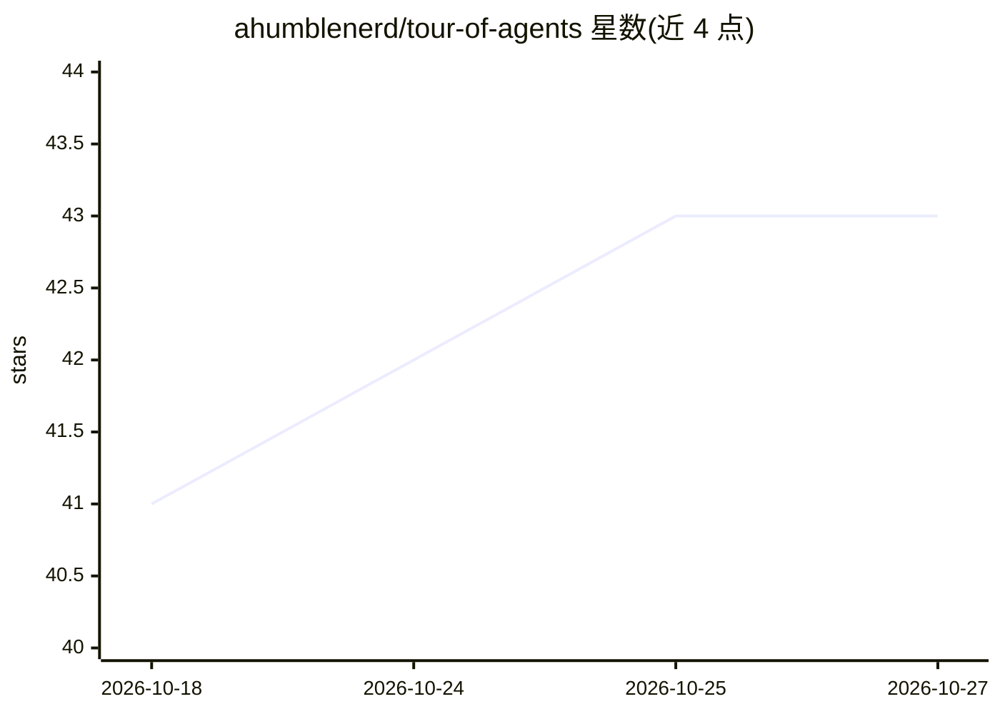

# ahumblenerd/tour-of-agents

⭐ 43 · TypeScript · MIT · 推送 2026-07-05 · [GitHub](https://github.com/ahumblenerd/tour-of-agents) · [官网](https://tinyagents.dev) · 个人维护

**30分钟交互课程：用60行纯Python从零构建AI agent**

面向开发者的浏览器端交互课程：通过九个渐进式课程，用纯 Python（仅依赖 json）从零构建一个完整 agent，覆盖工具调用、agent 循环、对话历史、结构化状态、持久记忆、输入/输出防护栏与自调度任务队列。代码经 Pyodide（WebAssembly 版 CPython）在浏览器内运行，无需安装，默认使用模拟 LLM 响应、无需 API key；接入真实模型支持 Groq、OpenAI、Anthropic、OpenRouter，密钥仅存于 localStorage。另含 26 个 agent 框架的对比页面与营销策略文档。

## 筛选速览

| 维度 | 判定 | 备注 |
|---|---|---|
| AI 角色 | `ai-knowledge` | 知识聚合/清单类 |
| 许可风险 | `permissive` | MIT |
| 部署形态 | `library` | 以包/库形式分发 |
| 模型依赖 | — | README 未给出锁定关系 |
| 硬件要求 | — | 无带数字的原话,不猜 |
| 安装摩擦 | `low` | 无编译、无系统依赖或容器化 |
| 成熟度 | — | 结构信号不足 |

## 能力要点

- 九课渐进式构建 ~60 行纯 Python 的完整 agent
- 浏览器内经 Pyodide 运行，无需安装，默认模拟 LLM 无需 API key
- 逐行展示 AgentExecutor/Crew/ConversableAgent 等框架封装的底层结构
- 26 个 agent 框架对比与 325 个自动生成的 head-to-head 页面

## 适用场景

- 想理解 agent 框架底层机制而非直接使用框架
- 系统学习 AI agent 的工具调用、循环、记忆与防护栏等概念
- 比较主流 agent 框架的定位与差异

## 场景标签

`教程课程` · 领域:学习与行业

## 证据(README 行号)

> L15: An interactive course that teaches how an AI agent actually works by building one — line by line, in plain Python, 
> L17: After lesson 1 you have an agent that can call an LLM. After lesson 9 you have a complete agent — tool calling, the
> L29: Agent frameworks abstract the same five primitives — a function, a dict, a while loop, a list, and another dict — i

## 星数曲线

2026-10-18 41 → 2026-10-27 43（+2）

---
*卡片 v1 · prompt 1.4 · 生成 2026-10-25 · 置信度 mid · 依据 README sha `3f01396eb8bd` · [字段定义](../../DATASET.md)*
