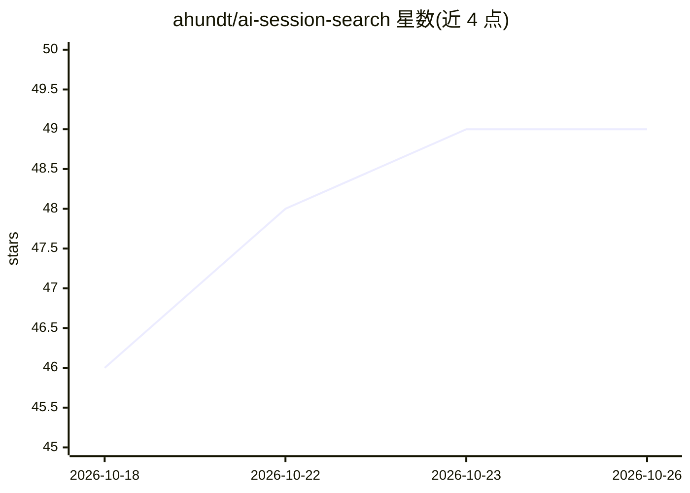

# ahundt/ai-session-search

⭐ 49 · Rust · Apache-2.0 · 推送 2026-10-25 · [GitHub](https://github.com/ahundt/ai-session-search) · [官网](https://github.com/ahundt/ai-session-search) · 个人维护

**本地 AI 编程会话的统一搜索与分析工具（Rust）**

Rust 实现的本地会话索引与搜索工具：解析 Claude Code、Claude Desktop、Codex、Cursor、Antigravity、Pi、Prime Agent、Google AI Studio、Gemini CLI 九种本地会话格式，统一建索引并增量刷新。同一核心以四种形式提供：aise 命令行、MCP 服务器、Rust crate 与 Python 包。支持会话/消息搜索、文件版本恢复与提取、resume、导出 Markdown、TUI 模糊搜索。全部数据从本地文件读取，不复制云端对话；性能数据基于约 250 万条消息索引在 Apple silicon 上的测试。

## 筛选速览

| 维度 | 判定 | 备注 |
|---|---|---|
| AI 角色 | `ai-ecosystem` | LLM/agent 周边工具 |
| 许可风险 | `permissive` | Apache-2.0 |
| 部署形态 | `library` | 以包/库形式分发 |
| 模型依赖 | — | README 未给出锁定关系 |
| 硬件要求 | — | 无带数字的原话,不猜 |
| 安装摩擦 | `low` | 无编译、无系统依赖或容器化 |
| 成熟度 | — | 结构信号不足 |

## 能力要点

- 九种 AI 编程工具的本地会话格式统一索引与增量刷新
- 同一 Rust 核心提供 CLI、MCP 服务器、Rust 库、Python 包四种接口
- MCP 服务器暴露 8 个只读工具，可在对话中被 agent 查询
- 支持文件版本历史提取、harness-notice 检索、会话导出 Markdown

## 适用场景

- 跨 Claude Code/Codex/Cursor 等工具检索历史编程会话
- 恢复 agent 曾写入或修改的文件版本
- 让编码 agent 通过 MCP 实时查询我过去的会话上下文
- 排查 agent 中途停止或被阻塞的原因

## 场景标签

 · 领域:AI 开发者工具/会话检索

## 证据(README 行号)

> L3: Ultra-fast rust-based search of every local AI coding session with on-the-fly reindexing. Reads Claude Code, Claude 
> L23: That index reaches you four ways: the `aise` command line, an MCP server your coding agent can
> L93: Eight tools are exposed: `search_sessions`, `search_messages`, `list_sessions`, `get_session`,

## 星数曲线

2026-10-18 46 → 2026-10-26 49（+3）

---
*卡片 v1 · prompt 1.4 · 生成 2026-10-24 · 置信度 high · 依据 README sha `719dc2e76e5f` · [字段定义](../../DATASET.md)*
