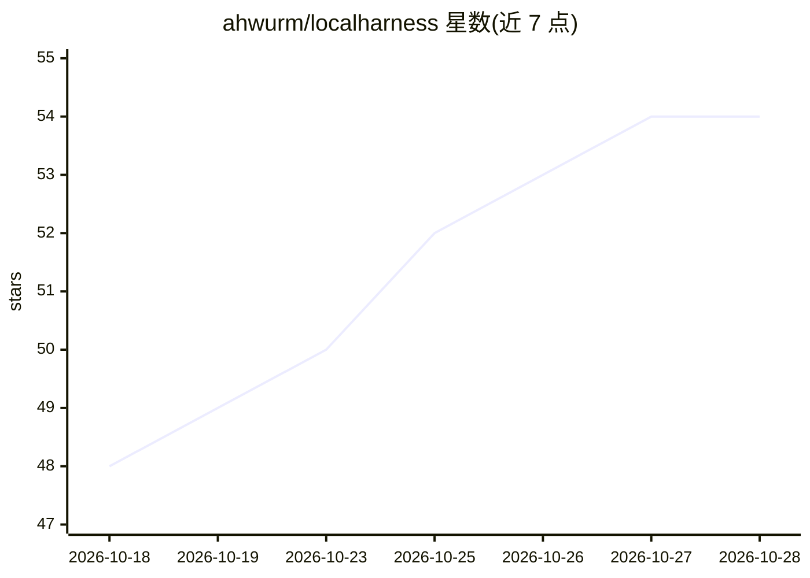

# ahwurm/localharness

⭐ 54 · Python · MIT · 推送 2026-10-25 · [GitHub](https://github.com/ahwurm/localharness) · [官网](https://localharness.dev) · 个人维护

**面向本地 LLM 的自托管 agent harness，含工具/权限门/插件**

开源、自托管的本地 LLM agent 框架：通过 OpenAI 兼容 API 连接 vLLM、llama.cpp、Ollama 或 LM Studio，也可代为启动模型服务。Agent 以 YAML 定义，内置读写、bash、web search、MCP 等工具，每次工具调用前有权限门检查（fail closed）。记忆、手机端、Discord、图像生成、无头浏览器等以插件形式按需开关，数据（SQLite 记忆、事件流、日志）留在本机，无账号无遥测。处于 pre-1.0 早期阶段，接口与配置可能变动。

## 筛选速览

| 维度 | 判定 | 备注 |
|---|---|---|
| AI 角色 | `ai-ecosystem` | LLM/agent 周边工具 |
| 许可风险 | `permissive` | MIT |
| 部署形态 | `None` |  |
| 模型依赖 | local-ok | 支持本地模型 |
| 硬件要求 | — | 无带数字的原话,不猜 |
| 安装摩擦 | `low` | 无编译、无系统依赖或容器化 |
| 成熟度 | `idea` | |

## 能力要点

- 支持 vLLM/llama.cpp/Ollama/LM Studio 四种本地运行时，统一 OpenAI 兼容客户端接入
- 每次工具调用前的权限门，读取不可信内容的 agent 不获得改机工具
- 从 GGUF tensor 表估算 llama.cpp 启动规格，读取模型自身上下文窗口定价
- 插件体系：记忆、手机页、Discord、ComfyUI 图像生成、沙箱无头浏览器等一条命令开关

## 适用场景

- 在本机模型上跑编码或研究 agent，无需账号和遥测
- 把现有本地模型服务接入带权限控制的 agent 框架
- 通过手机、Zed 或 Discord 远程驱动本地 agent 会话

## 场景标签

`Agent 框架` · 领域:Agent 开发

## 证据(README 行号)

> L9: LocalHarness is an open-source, self-hosted agent harness for local LLMs. It connects to a model you serve over an O
> L39: Point it at vLLM, llama.cpp, Ollama or LM Studio; the agents, tools, permission gate and plugins are the same on al

## 星数曲线

2026-10-18 48 → 2026-10-28 54（+6）

---
*卡片 v1 · prompt 1.4 · 生成 2026-10-24 · 置信度 high · 依据 README sha `9e46f9d76153` · [字段定义](../../DATASET.md)*
