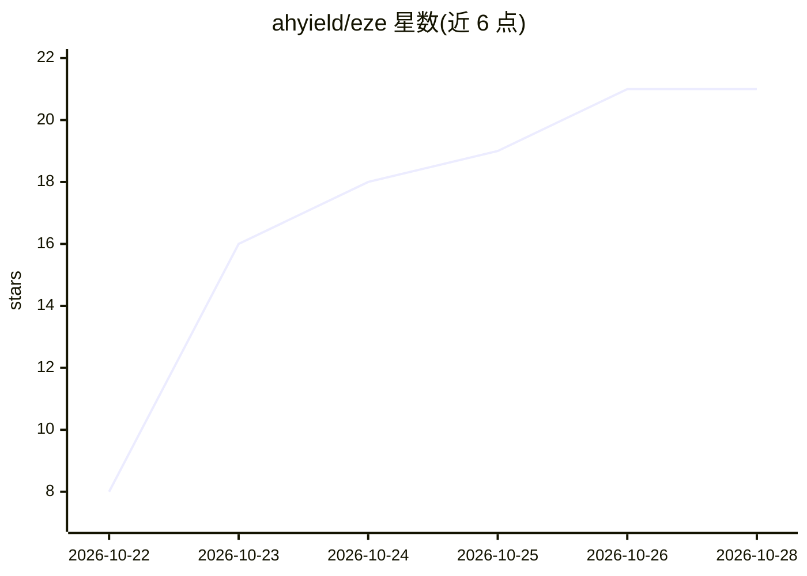

# ahyield/eze

⭐ 21 · Go · MIT · 推送 2026-10-26 · [GitHub](https://github.com/ahyield/eze) · [官网](https://eze.page) · 个人维护

**自托管团队内部静态网站平台：上传 HTML 文件夹即得私有链接**

单二进制 Go 服务器加 SQLite 文件的自托管平台：上传一个 HTML 文件夹即可在通配符域名下生成仅限本组织成员访问的私有站点。每个站点通过浏览器 SDK 获得数据库、实时更新、文件上传、多人房间、AI 调用（eze.ai，支持 Anthropic/OpenAI/OpenAI 兼容服务含 Ollama）与访问者身份。认证强制启用，支持 OIDC、header 代理和本地 dev 三种模式；提供 MCP 工具集让 AI 助手读取 SDK 文档并部署站点。面向单一组织内部可信成员，拒绝公共邮箱域名启动；AI 支出按人每日 token 预算限流并记录于 ai_usage 表。

## 筛选速览

| 维度 | 判定 | 备注 |
|---|---|---|
| AI 角色 | `ai-enhanced` | 去掉 AI 部分产品仍成立 |
| 许可风险 | `permissive` | MIT |
| 部署形态 | `self-host` | docker 或自建部署 |
| 模型依赖 | local-ok | 支持本地模型 |
| 硬件要求 | — | 无带数字的原话,不猜 |
| 安装摩擦 | `low` | 无编译、无系统依赖或容器化 |
| 成熟度 | — | 结构信号不足 |

## 能力要点

- 单二进制 + 单 SQLite 文件，站点即文件夹、原子化替换部署
- 浏览器 SDK 提供数据库、实时更新、上传、多人房间、AI 与身份，无需配置
- eze mcp 提供 MCP 工具集（sdk_docs/deploy_folder/query_collection 等）供 AI 客户端调用
- 强制认证（OIDC/header/dev），AI 使用按人每日 token 预算与并发上限约束

## 适用场景

- 团队内部快速发布投票、看板等小型内部网页
- 让 Claude Code 等 AI 助手通过 MCP 直接构建并部署内部站点
- 组织内自托管站点托管并统一管控 AI 支出

## 场景标签

 · 领域:部署/内部工具托管

## 证据(README 行号)

> L6: No frameworks, pipelines or config files. Need data? Every site gets a database, realtime updates, file uploads,
> L9: An open-source take on the idea behind Shopify's internal Quick platform.

## 星数曲线

2026-10-22 8 → 2026-10-28 21（+13）

---
*卡片 v1 · prompt 1.4 · 生成 2026-10-28 · 置信度 high · 依据 README sha `3af87e143065` · [字段定义](../../DATASET.md)*
