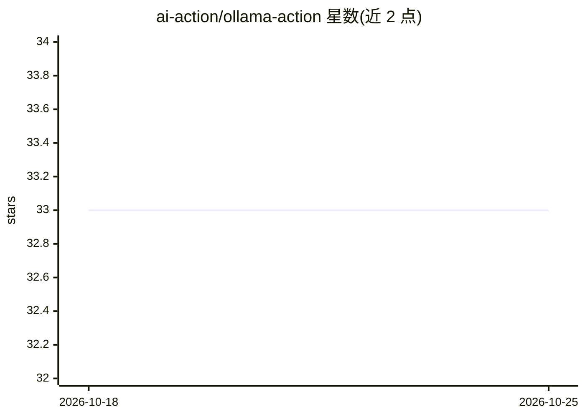

# ai-action/ollama-action

⭐ 33 · MIT · 推送 2026-06-24 · [GitHub](https://github.com/ai-action/ollama-action) · [官网](https://github.com/marketplace/actions/ollama-action) · 个人维护

**GitHub Action：在 CI 工作流中运行 Ollama 大语言模型**

一个 composite GitHub Action（ai-action/ollama-action@v2），在 GitHub Actions 工作流中运行 Ollama 大语言模型。输入包括必填的 model 与 prompt（支持多行），可选的 version（指定 Ollama 版本）与 cache（默认缓存模型）。输出为 response，即生成的文本回复。面向需要在 CI 流水线中调用 LLM 的开发者，例如自动生成 PR 标题等场景。以 MIT 许可发布。

## 筛选速览

| 维度 | 判定 | 备注 |
|---|---|---|
| AI 角色 | `ai-ecosystem` | LLM/agent 周边工具 |
| 许可风险 | `permissive` | MIT |
| 部署形态 | `None` |  |
| 模型依赖 | local-ok | 支持本地模型 |
| 硬件要求 | — | 无带数字的原话,不猜 |
| 安装摩擦 | `low` | 无编译、无系统依赖或容器化 |
| 成熟度 | — | 结构信号不足 |

## 能力要点

- 以 GitHub Action 形式封装 Ollama，工作流中声明即可调用
- 支持指定模型、多行 prompt、Ollama 版本与模型缓存
- 输出 response 供后续步骤使用，保留换行

## 适用场景

- 在 CI 中对指定模型发送 prompt 并获取生成文本
- 为自动化 PR 生成标题等描述文本
- 在 GitHub Actions 中缓存模型以加速重复调用

## 场景标签

 · 领域:CI/CD 与 LLM 工具链

## 证据(README 行号)

> L9: 🦙 Run Ollama large language models (LLMs) with GitHub Actions.
> L25: - uses: ai-action/ollama-action@v2

## 星数曲线

2026-10-18 33 → 2026-10-25 33（+0）

---
*卡片 v1 · prompt 1.4 · 生成 2026-10-25 · 置信度 high · 依据 README sha `cc2f05b51c1a` · [字段定义](../../DATASET.md)*
