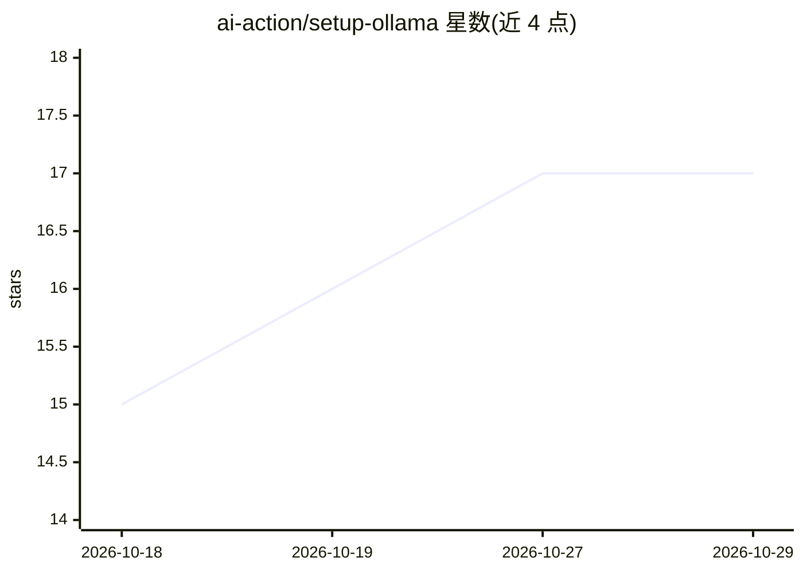

# ai-action/setup-ollama

⭐ 17 · TypeScript · MIT · 推送 2026-10-28 · [GitHub](https://github.com/ai-action/setup-ollama) · [官网](https://github.com/marketplace/actions/setup-ollama) · 组织维护

**在 GitHub Actions 中安装 Ollama CLI 的 Action**

TypeScript 编写的 GitHub Action，用于在 CI 工作流中安装 Ollama CLI，使工作流可直接执行 ollama run 等命令运行模型或提示词。支持指定 CLI 版本（默认 0.40.12）与命令名，可配合 actions/cache 缓存 ~/.ollama 目录加速 CI。文档说明 Linux 自托管 runner 需安装 zstd（或改用 0.14.0 以下版本）。MIT 许可，当前版本 v2。

## 筛选速览

| 维度 | 判定 | 备注 |
|---|---|---|
| AI 角色 | `ai-ecosystem` | LLM/agent 周边工具 |
| 许可风险 | `permissive` | MIT |
| 部署形态 | `None` |  |
| 模型依赖 | local-ok | 支持本地模型 |
| 硬件要求 | — | 无带数字的原话,不猜 |
| 安装摩擦 | `low` | 无编译、无系统依赖或容器化 |
| 成熟度 | — | 结构信号不足 |

## 能力要点

- 在工作流中以 uses: ai-action/setup-ollama@v2 一行安装 Ollama CLI
- 可指定 CLI 版本（默认 0.40.12）与命令名
- 配合 actions/cache 缓存模型目录加速 CI
- 处理自托管 runner 的 zstd 依赖问题并给出方案

## 适用场景

- 在 CI 中运行本地模型推理或提示词测试
- 为 LLM 相关项目提供可复现的 Ollama 环境
- 在自托管 runner 上自动安装指定版本 Ollama

## 场景标签

 · 领域:开发者工具/CI

## 证据(README 行号)

> L9: 🦙 Set up GitHub Actions workflow with Ollama.
> L31: - run: ollama run gemma4 "What's a large language model?"

## 星数曲线

2026-10-18 15 → 2026-10-29 17（+2）

---
*卡片 v1 · prompt 1.4 · 生成 2026-10-29 · 置信度 high · 依据 README sha `8c1419960bd8` · [字段定义](../../DATASET.md)*
