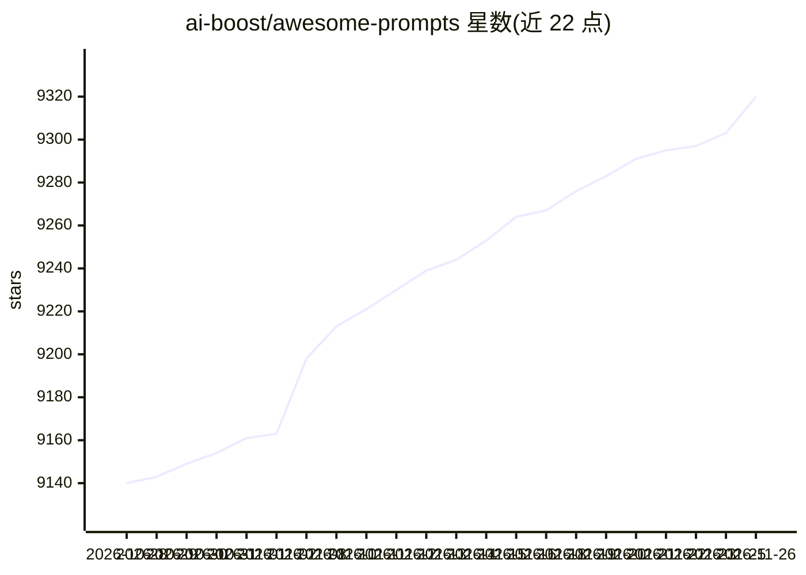

# ai-boost/awesome-prompts

⭐ 9,320 · Python · GPL-3.0 · 推送 2026-11-25 · [GitHub](https://github.com/ai-boost/awesome-prompts) · [官网](https://agentcraft.dev/en/prompts/agents/) · 组织维护 · 中文 README

**面向 LLM/Agent 使用者的提示词与论文策展清单**

以清单形式收录面向 LLM 与 agent 的提示词、框架条目与论文，含 3,099 条日常提示词，覆盖编码开发、写作、营销、图像设计、角色扮演等 16 个类别，每条提供中英双语版本并标注机器翻译来源。条目以表格展示并链接 prompt 原文，另提供在线画廊（agentcraft.dev）按类别浏览及 Hugging Face 数据集下载，并附带 Claude Code 技能目录。原始数据以 CSV 形式发布，来源与许可在子目录说明。

## 筛选速览

| 维度 | 判定 | 备注 |
|---|---|---|
| AI 角色 | `ai-knowledge` | 知识聚合/清单类 |
| 许可风险 | `viral` | GPL-3.0 |
| 部署形态 | `None` |  |
| 模型依赖 | — | README 未给出锁定关系 |
| 硬件要求 | — | 无带数字的原话,不猜 |
| 安装摩擦 | `low` | 无编译、无系统依赖或容器化 |
| 成熟度 | — | 结构信号不足 |

## 能力要点

- 收录 3,099 条日常提示词，覆盖 16 个类别
- 每条提示词提供英文与中文双语版本，并标注机器翻译条目
- 提供在线画廊与 Hugging Face 数据集两种访问方式
- 附 Claude Code 技能目录

## 适用场景

- 为编码/写作/营销等任务查找现成提示词
- 查找 agent harness 与上下文工程相关的论文与设计模式
- 批量下载数据集做提示词相关分析

## 场景标签

`精选清单` · 领域:学习与行业

## 证据(README 行号)

> L5:  Curated prompts, frameworks, and papers for LLMs — with an engineering bias.
> L27: Browse the Prompts below by category, with a preview of each, on agentcraft.dev.
> L33: **3,099 everyday prompts** for writing, coding, marketing, study, design and more. Every prompt comes in English an

## 星数曲线

2026-10-28 9,140 → 2026-11-26 9,320（+180）

---
*卡片 v1 · prompt 1.4 · 生成 2026-11-22 · 置信度 high · 依据 README sha `2ebd429bf750` · [字段定义](../../DATASET.md)*
