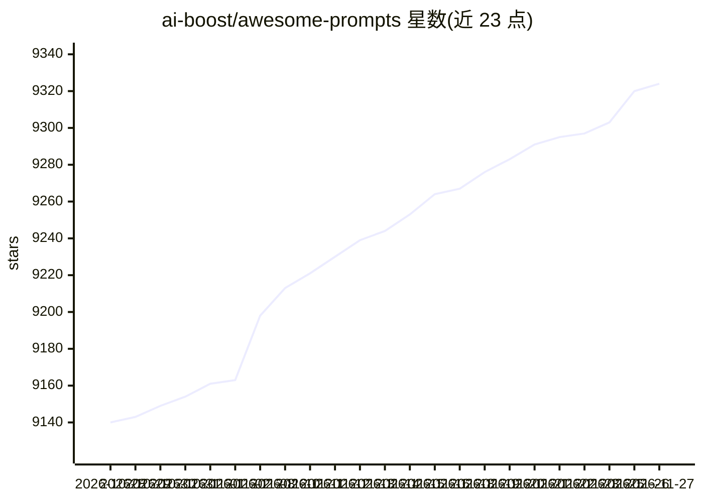

# ai-boost/awesome-prompts

⭐ 9,324 · Python · GPL-3.0 · 推送 2026-11-26 · [GitHub](https://github.com/ai-boost/awesome-prompts) · [官网](https://agentcraft.dev/en/prompts/agents/) · 组织维护 · 中文 README

**面向开发者与 agent 工程的 LLM 提示词、框架与论文清单**

一个 awesome 类提示词聚合清单：收录 3,239 条日常提示词，覆盖编程、写作、营销、教育、研究等 16 个类别，每条提供英文与中文双语版本（其中 1,190 条标注为机器翻译）；另含面向 Claude Code、Codex、Cline 等编码 agent 的提示词工程条目，以及 agent harness、上下文工程、红队等方向的内容与论文索引。条目以表格加 CSV 原始数据形式提供，并提供在线浏览站点与 Hugging Face 数据集。

## 筛选速览

| 维度 | 判定 | 备注 |
|---|---|---|
| AI 角色 | `ai-knowledge` | 知识聚合/清单类 |
| 许可风险 | `viral` | GPL-3.0 |
| 部署形态 | `None` |  |
| 模型依赖 | — | README 未给出锁定关系 |
| 硬件要求 | — | 无带数字的原话,不猜 |
| 安装摩擦 | `low` | 无编译、无系统依赖或容器化 |
| 成熟度 | — | 结构信号不足 |

## 能力要点

- 3,239 条双语提示词，按 16 个类别组织，附 CSV 原始数据
- 收录针对 Claude Code、Codex CLI、Cline、Kimi Code 等工具的提示词架构条目
- 包含 agent harness 设计、循环工程、多 agent 编排等工程向内容
- 提供在线画廊与 Hugging Face 数据集两种访问形式

## 适用场景

- 为编码 agent 工具寻找经过整理的系统提示词模板
- 查找中英双语的日常写作、营销、学习类提示词
- 了解 agent harness 与提示词工程方向的相关论文与实践

## 场景标签

`提示工程` `精选清单` · 领域:Agent 开发

## 证据(README 行号)

> L5:  Curated prompts, frameworks, and papers for LLMs — with an engineering bias.
> L33: **3,239 everyday prompts** for writing, coding, marketing, study, design and more. Every prompt comes in English an

## 星数曲线

2026-10-28 9,140 → 2026-11-27 9,324（+184）

---
*卡片 v1 · prompt 1.4 · 生成 2026-11-26 · 置信度 high · 依据 README sha `8b469cb4671c` · [字段定义](../../DATASET.md)*
