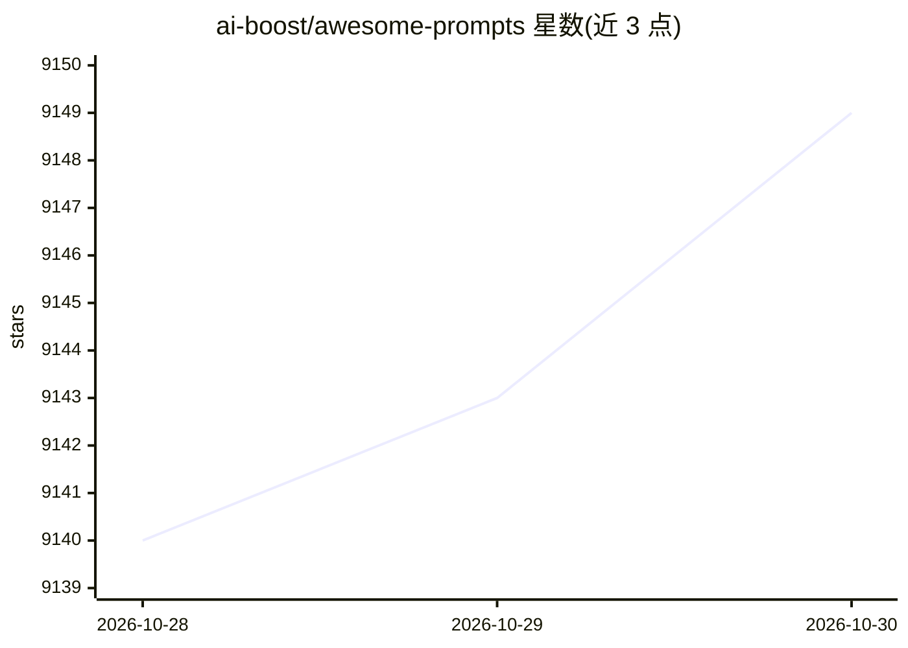

# ai-boost/awesome-prompts

⭐ 9,149 · Python · GPL-3.0 · 推送 2026-10-29 · [GitHub](https://github.com/ai-boost/awesome-prompts) · [官网](https://agentcraft.dev/en/prompts/agents/) · 组织维护

**面向工程实践的 LLM/Agent 提示词、框架与论文策展清单**

Awesome 系列清单仓库，收录面向提示工程、上下文工程与 agent 运行时设计的提示词条目、框架与论文，自述偏向工程视角而非模板收集。提示词条目按编码开发、多智能体编排、agent harness 设计、循环工程、成本可观测等主题组织，每个条目注明所基于的上游项目、论文或官方指南（含许可证与 star 数信息），提供 12 种语言的 README 翻译。条目以表格列出并附 prompt 链接，可直接复制使用。

## 筛选速览

| 维度 | 判定 | 备注 |
|---|---|---|
| AI 角色 | `ai-knowledge` | 知识聚合/清单类 |
| 许可风险 | `viral` | GPL-3.0 |
| 部署形态 | `None` |  |
| 模型依赖 | — | README 未给出锁定关系 |
| 硬件要求 | — | 无带数字的原话,不猜 |
| 安装摩擦 | `low` | 无编译、无系统依赖或容器化 |
| 成熟度 | — | 结构信号不足 |

## 能力要点

- 同时覆盖提示模板与提示工程（编译/测试/优化 LM 程序）两条路线
- 每条提示注明基于的上游项目、arXiv 论文或官方指南及来源信息
- 提供 12 种语言的 README 翻译
- 条目覆盖编码 agent、多智能体编排、agent harness 设计、循环工程等主题

## 适用场景

- 为编码 agent 或多智能体系统挑选现成系统提示词
- 跟踪提示工程与 agent harness 领域的论文与工具来源
- 查找特定 CLI 工具（Gemini CLI/Codex/Cline 等）的优化提示写法

## 场景标签

`精选清单` `提示工程` · 领域:Agent 开发

## 证据(README 行号)

> L3:  Curated prompts, frameworks, and papers — with an engineering bias.
> L20: - **Camp 1 — Prompt templates**: collect system prompts, share copy-paste recipes, curate persona prompts. Useful, 
> L21: - **Camp 2 — Prompt as engineering**: compile LM programs (DSPy), test and regress prompts (promptfoo), control gen

## 星数曲线

2026-10-28 9,140 → 2026-10-30 9,149（+9）

---
*卡片 v1 · prompt 1.4 · 生成 2026-10-28 · 置信度 high · 依据 README sha `214e18537e19` · [字段定义](../../DATASET.md)*
