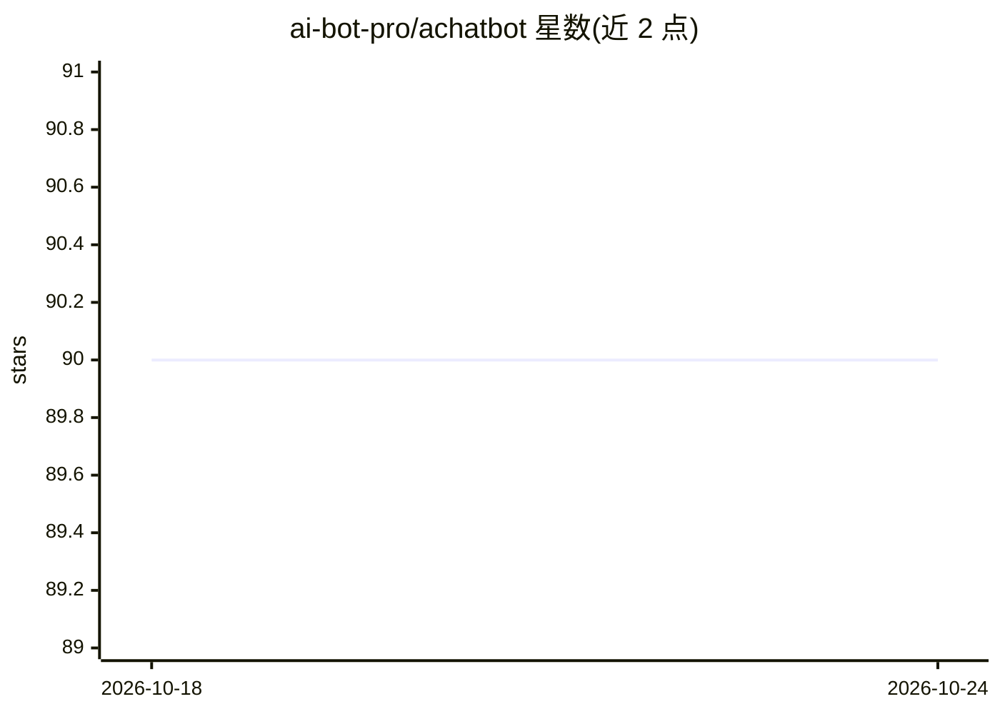

# ai-bot-pro/achatbot

⭐ 90 · Python · BSD-3-Clause · 推送 2025-12-28 · [GitHub](https://github.com/ai-bot-pro/achatbot) · 组织维护 · 中文 README

**构建语音/视觉多模态聊天机器人的开源框架**

Python 编写的聊天机器人架构库，以 pipeline 设计组织 VAD、ASR、LLM/多模态 LLM、TTS、数字人（avatar）、OCR、目标检测等模块，支持本地（CPU/GPU）与远程两种运行形态。支持 MCP 与 A2A 协议，提供 fastapi bot server 等可选依赖组合，内置 SenseVoice、edge-tts、LiteAvatar、LAM_audio2expression 等处理器；附带 websocket/WebRTC 语音数字人 Web UI 与 Docker 部署方式。要求 Python 3.10–3.12，通过 PyPI 安装。

## 筛选速览

| 维度 | 判定 | 备注 |
|---|---|---|
| AI 角色 | `ai-ecosystem` | LLM/agent 周边工具 |
| 许可风险 | `permissive` | BSD-3-Clause |
| 部署形态 | `library` | 以包/库形式分发 |
| 模型依赖 | — | README 未给出锁定关系 |
| 硬件要求 | — | 无带数字的原话,不猜 |
| 安装摩擦 | `medium` | 含编译或系统依赖之一 |
| 成熟度 | — | 结构信号不足 |

## 能力要点

- pipeline 架构串联 VAD/ASR/LLM/TTS/数字人/OCR 等处理器
- 支持 MCP 与 Agent2Agent (A2A) 协议
- 本地 LAM_audio2expression 数字人可 Docker 部署，配套 WebRTC Web UI
- 提供 litellm/openai/google/together 等多种 LLM processor 可选依赖

## 适用场景

- 快速搭建带语音输入输出的对话机器人
- 构建带数字人口型的实时语音 avatar 助手
- 通过插件式 processor 组合替换 ASR/LLM/TTS 后端

## 场景标签

`语音 Agent` `多模态` `Agent 框架` · 领域:Agent 开发

## 证据(README 行号)

> L7: achatbot factory, create chat bots with vad,turn, asr, llm(tools)/mllm/audio-llm/omni-llm, tts, avatar, ocr, detect 
> L20: - ⭐️ pipeline design ⭐️
> L65: pip install "dist/achatbot-{$version}-py3-none-any.whl[fastapi_bot_server,livekit,livekit-api,daily,agora,silero_va

## 星数曲线

2026-10-18 90 → 2026-10-24 90（+0）

---
*卡片 v1 · prompt 1.4 · 生成 2026-10-23 · 置信度 mid · 依据 README sha `871e7be92f29` · [字段定义](../../DATASET.md)*
