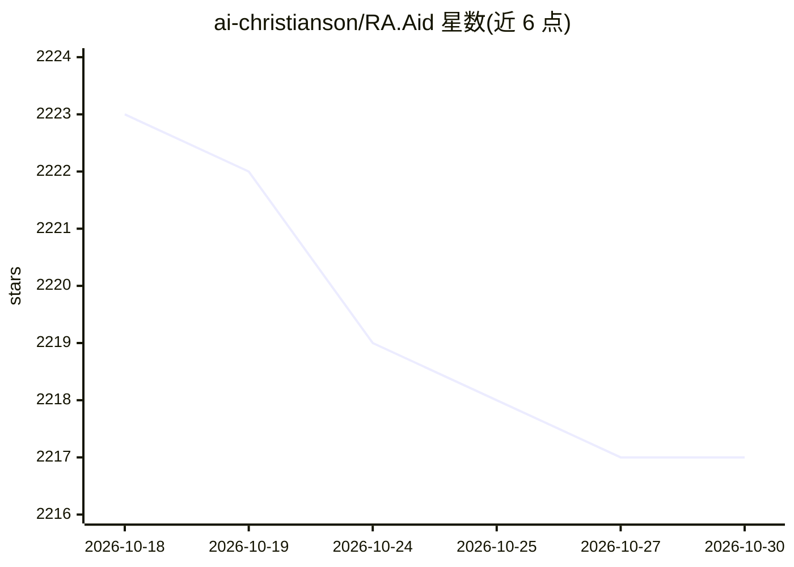

# ai-christianson/RA.Aid

⭐ 2,217 · Python · Apache-2.0 · 推送 2026-01-30 · [GitHub](https://github.com/ai-christianson/RA.Aid) · [官网](https://ra-aid.ai/) · 个人维护

**自主软件开发编程 Agent：研究-规划-实现三阶段执行任务**

基于 LangGraph 的独立命令行编程 Agent，将开发任务分为研究、规划、实现三阶段，由各阶段专用 Agent 与工具集（shell 执行、文件操作、内存管理、代码分析）依次完成多步编程任务。支持为研究/规划/专家查询分别指定模型与提供商，可选集成 aider 做代码编辑，可选人在环路交互模式与 Web 界面（alpha）。需配置 LLM API key 运行；Web 研究功能依赖 Tavily API。以 Python 包发布，另提供 Homebrew 安装。

## 筛选速览

| 维度 | 判定 | 备注 |
|---|---|---|
| AI 角色 | `ai-native` | 本体是模型或模型工具 |
| 许可风险 | `permissive` | Apache-2.0 |
| 部署形态 | `library` | 以包/库形式分发 |
| 模型依赖 | locked-api |  |
| 硬件要求 | — | 无带数字的原话,不猜 |
| 安装摩擦 | `low` | 无编译、无系统依赖或容器化 |
| 成熟度 | `idea` | |

## 能力要点

- 研究-规划-实现三阶段架构处理多步编程任务
- 研究/规划/专家查询可分别指定 provider 与 model
- 可选 aider 集成、human-in-the-loop 模式与 web 界面（alpha）
- 自动 shell 命令执行与测试命令运行

## 适用场景

- 让 Agent 研究代码库并回答架构问题
- 规划和实现跨多文件的功能变更或重构
- 全代码库批量更新废弃 API 调用

## 场景标签

`编码 Agent` · 领域:编码与开发

## 证据(README 行号)

> L9: RA.Aid (pronounced "raid") helps you develop software autonomously. It is a standalone coding agent built on LangGra
> L45: - **Three-Stage Architecture**:
> L46:  1. **Research**: Analyzes codebases and gathers context
> L47:  2. **Planning**: Breaks down tasks into specific, actionable steps
> L48:  3. **Implementation**: Executes each planned step sequentially

## 星数曲线

2026-10-18 2,223 → 2026-10-30 2,217（-6）

---
*卡片 v1 · prompt 1.4 · 生成 2026-10-21 · 置信度 high · 依据 README sha `34f64a2c5bbc` · [字段定义](../../DATASET.md)*
