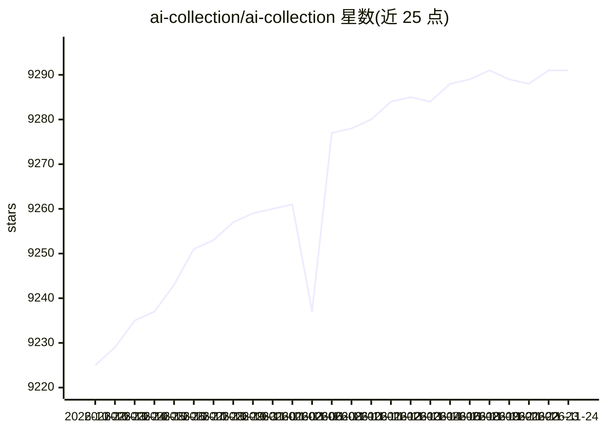

# ai-collection/ai-collection

⭐ 9,291 · MIT · 推送 2026-11-20 · [GitHub](https://github.com/ai-collection/ai-collection) · [官网](https://www.thataicollection.com/) · 个人维护 · 中文 README

**生成式 AI 应用精选清单：按 70+ 类目收录产品条目**

一个以 awesome-list 形式维护的生成式 AI 应用聚合目录，按 AI Agents、Art & Illustration、Detector & Humanizer、Chat Bot、Coding Assistant 等 70 余个类目组织条目，每条含名称、简介、访问与定价链接；另设 Top Picks 推荐区和 Latest Additions 最新收录区，提供多语言翻译 README，收录通过联系维护者提交，条目以外部商业/在线产品链接为主，仓库本身不提供可安装的软件。

## 筛选速览

| 维度 | 判定 | 备注 |
|---|---|---|
| AI 角色 | `ai-knowledge` | 知识聚合/清单类 |
| 许可风险 | `permissive` | MIT |
| 部署形态 | `None` |  |
| 模型依赖 | — | README 未给出锁定关系 |
| 硬件要求 | — | 无带数字的原话,不猜 |
| 安装摩擦 | `low` | 无编译、无系统依赖或容器化 |
| 成熟度 | — | 结构信号不足 |

## 能力要点

- 按 70+ 类目组织的生成式 AI 应用条目
- Top Picks 与 Latest Additions 动态更新机制
- 提供西语/法语/俄语/印地语/简体中文等多语言版本
- 条目统一含 Visit 与 Pricing 链接

## 适用场景

- 按用途类目浏览和发现生成式 AI 在线产品
- 为自己的 AI 应用寻找被收录曝光的渠道
- 跟踪生成式 AI 应用生态的最新收录动态

## 场景标签

`精选清单` · 领域:学习与行业

## 证据(README 行号)

> L5:  THE GENERATIVE AI LANDSCAPE
> L58: ### A hand-picked list of awesome AI applications featured on AI Collection
> L62: ## Index

## 星数曲线

2026-10-22 9,225 → 2026-11-24 9,291（+66）

---
*卡片 v1 · prompt 1.4 · 生成 2026-11-22 · 置信度 high · 依据 README sha `08e9351a7e08` · [字段定义](../../DATASET.md)*
