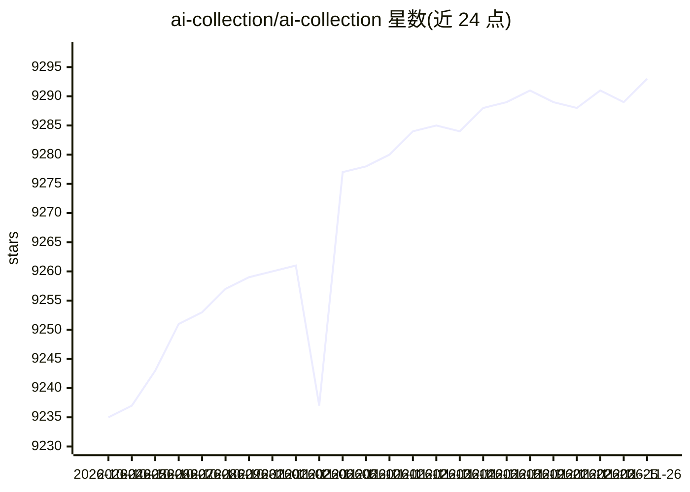

# ai-collection/ai-collection

⭐ 9,293 · MIT · 推送 2026-11-24 · [GitHub](https://github.com/ai-collection/ai-collection) · [官网](https://www.thataicollection.com/) · 个人维护 · 中文 README

**生成式 AI 应用精选清单：按 80+ 类别收录在线应用**

维护生成式 AI 应用的聚合清单，按 AI Agents、文本生成、图像/视频/音乐生成、写作助手等 80 余个类别组织条目，每条包含名称、一句话描述与站点链接，并设 Top Picks 与最新收录板块。清单本身不提供可安装软件，收录对象多为商业在线应用，主要供用户浏览与检索生成式 AI 工具；提供多语言翻译 README 与贡献指南。

## 筛选速览

| 维度 | 判定 | 备注 |
|---|---|---|
| AI 角色 | `ai-knowledge` | 知识聚合/清单类 |
| 许可风险 | `permissive` | MIT |
| 部署形态 | `None` |  |
| 模型依赖 | — | README 未给出锁定关系 |
| 硬件要求 | — | 无带数字的原话,不猜 |
| 安装摩擦 | `low` | 无编译、无系统依赖或容器化 |
| 成熟度 | — | 结构信号不足 |

## 能力要点

- 按 80+ 类别组织的生成式 AI 应用索引
- 每个条目含描述、Visit 与定价信息链接
- Top Picks 与 Latest Additions 板块
- 提供西语/法语/俄语/印地语/简体中文翻译

## 适用场景

- 想按任务类别浏览有哪些生成式 AI 应用可用
- 为某类工作（如视频配音、简历生成）查找候选工具
- 向该清单提交自己的 AI 应用以获得曝光

## 场景标签

`精选清单` · 领域:学习与行业

## 证据(README 行号)

> L5:  THE GENERATIVE AI LANDSCAPE
> L58: ### A hand-picked list of awesome AI applications featured on AI Collection
> L62: ## Index

## 星数曲线

2026-10-24 9,235 → 2026-11-26 9,293（+58）

---
*卡片 v1 · prompt 1.4 · 生成 2026-11-26 · 置信度 high · 依据 README sha `18472e7d8f38` · [字段定义](../../DATASET.md)*
