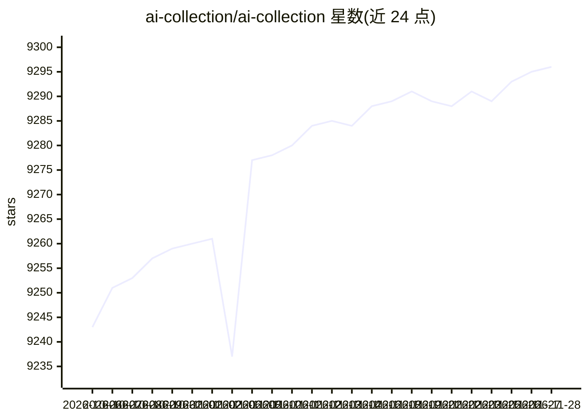

# ai-collection/ai-collection

⭐ 9,296 · MIT · 推送 2026-11-27 · [GitHub](https://github.com/ai-collection/ai-collection) · [官网](https://www.thataicollection.com/) · 个人维护

**生成式 AI 应用目录：按 70+ 类别收录各领域应用**

维护生成式 AI 应用的精选清单（awesome list），按 AI Agents、艺术与插画、音乐生成、聊天机器人、写作助手、文本转图像/视频等 70 多个类别组织条目；每个条目含名称、简介、访问链接与定价信息，站点为 thataicollection.com。提供多语言翻译 README（西/法/俄/印地/简体中文），含 Top Picks 推荐位与贡献指南，收录对象以商业 SaaS 应用为主。

## 筛选速览

| 维度 | 判定 | 备注 |
|---|---|---|
| AI 角色 | `ai-knowledge` | 知识聚合/清单类 |
| 许可风险 | `permissive` | MIT |
| 部署形态 | `None` |  |
| 模型依赖 | — | README 未给出锁定关系 |
| 硬件要求 | — | 无带数字的原话,不猜 |
| 安装摩擦 | `low` | 无编译、无系统依赖或容器化 |
| 成熟度 | — | 结构信号不足 |

## 能力要点

- 按 70+ 类别组织生成式 AI 应用条目
- 每个条目提供简介、访问链接与定价信息
- 提供 5 种语言的 README 翻译
- 配套网站 thataicollection.com 与贡献指南

## 适用场景

- 按类别浏览查找某类生成式 AI 应用
- 为自己的 AI 产品提交收录
- 跟踪最新收录的生成式 AI 应用

## 场景标签

`聊天机器人` `AI 写作` `精选清单` · 领域:对话与助手

## 证据(README 行号)

> L5:  THE GENERATIVE AI LANDSCAPE
> L62: ## Index

## 星数曲线

2026-10-26 9,243 → 2026-11-28 9,296（+53）

---
*卡片 v1 · prompt 1.4 · 生成 2026-11-28 · 置信度 high · 依据 README sha `ce32c929d775` · [字段定义](../../DATASET.md)*
