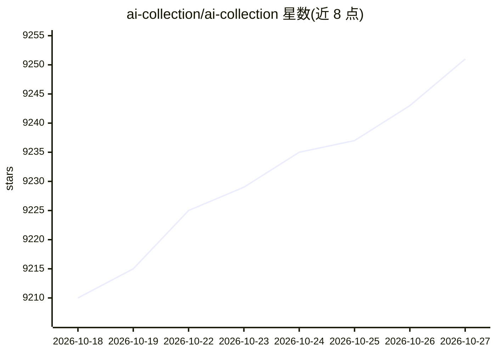

# ai-collection/ai-collection

⭐ 9,251 · MIT · 推送 2026-10-25 · [GitHub](https://github.com/ai-collection/ai-collection) · [官网](https://www.thataicollection.com/) · 个人维护 · 中文 README

**生成式 AI 应用策展清单：按类别收录各类 AI 应用条目**

以 awesome list 形式收录生成式 AI 应用的目录：条目按 AI Agent、AI 艺术插画、AI 检测、写作助手、文生图/文生视频等数十个类别组织，每个条目含名称、简介与官网链接，并设 Top Picks 与最新收录区块。部分条目为闭源商业产品，仅作信息罗列。提供多语言 README 翻译（西/法/俄/印地/简中），配套 Contributing Guide 与网站。

## 筛选速览

| 维度 | 判定 | 备注 |
|---|---|---|
| AI 角色 | `ai-knowledge` | 知识聚合/清单类 |
| 许可风险 | `permissive` | MIT |
| 部署形态 | `None` |  |
| 模型依赖 | — | README 未给出锁定关系 |
| 硬件要求 | — | 无带数字的原话,不猜 |
| 安装摩擦 | `low` | 无编译、无系统依赖或容器化 |
| 成熟度 | — | 结构信号不足 |

## 能力要点

- 数十个类别组织的生成式 AI 应用条目目录
- 每条目提供简介与官网跳转链接
- 多语言 README 翻译（含简体中文）
- 设 Top Picks 与最新收录区块

## 适用场景

- 按类别查找生成式 AI 应用工具
- 了解生成式 AI 应用的类别覆盖情况
- 提交自己的 AI 应用进入收录

## 场景标签

`精选清单` · 领域:学习与行业

## 证据(README 行号)

> L5:  THE GENERATIVE AI LANDSCAPE
> L7:  A Collection of Awesome Generative AI Applications
> L62: ## Index

## 星数曲线

2026-10-18 9,210 → 2026-10-27 9,251（+41）

---
*卡片 v1 · prompt 1.4 · 生成 2026-10-20 · 置信度 high · 依据 README sha `5ae371507a54` · [字段定义](../../DATASET.md)*
