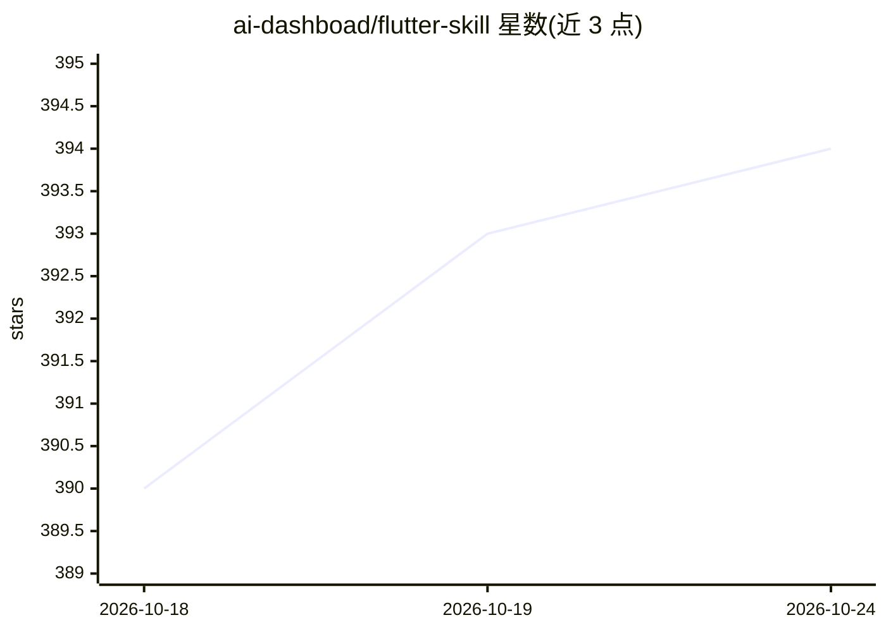

# ai-dashboad/flutter-skill

⭐ 395 · Dart · MIT · 推送 2026-09-01 · [GitHub](https://github.com/ai-dashboad/flutter-skill) · [官网](https://ai-dashboad.github.io/flutter-skill/) · 组织维护

**让 AI agent 用自然语言对 10 平台应用做 E2E 测试的 MCP 服务器**

面向 Flutter、React Native、iOS、Android、Web、Electron、Tauri、KMP、.NET MAUI 等 10 类平台的 MCP 测试服务器，提供 253 个工具（截图、点击、输入、断言、视觉回归、网络 mock、多设备同步等），通过 Claude、Cursor、Windsurf、Copilot 等 MCP 兼容 agent 以自然语言驱动，无需编写测试代码；Flutter 侧需在应用中加入 2 行初始化代码，另有 HTTP serve 模式用于 CLI 与 CI/CD。以无障碍树代替截图以减少 token 消耗。提供 npm、Homebrew、Scoop、Docker 等安装途径。

## 筛选速览

| 维度 | 判定 | 备注 |
|---|---|---|
| AI 角色 | `ai-ecosystem` | LLM/agent 周边工具 |
| 许可风险 | `permissive` | MIT |
| 部署形态 | `self-host` | docker 或自建部署 |
| 模型依赖 | — | README 未给出锁定关系 |
| 硬件要求 | — | 无带数字的原话,不猜 |
| 安装摩擦 | `low` | 无编译、无系统依赖或容器化 |
| 成熟度 | — | 结构信号不足 |

## 能力要点

- 253 个 MCP 工具，覆盖 10 个平台（Flutter 188/195 测试通过）
- MCP stdio 与 HTTP REST 两种运行模式，分别用于 IDE 集成与 CLI/CI
- 以无障碍树快照代替截图，声明单页约 200 token
- 支持视觉回归、网络 mock/replay、多设备并行、无障碍审计、录制导出多框架格式

## 适用场景

- 用 Claude/Cursor 等 agent 以自然语言探索应用并报告 bug
- 替代手写 Page Object/XPath 的 E2E 测试流程
- CI/CD 中通过 HTTP 模式做跨平台自动化测试

## 场景标签

`GUI 自动化` · 领域:效率与自动化

## 证据(README 行号)

> L37: - 🔌 **Connects any AI agent** (Claude, Cursor, Windsurf, Copilot, OpenClaw) directly to your running app via MCP
> L155: |**Use case**|IDE / AI agent integration|CLI / automation / CI/CD|

## 星数曲线

2026-10-18 390 → 2026-10-24 394（+4）

---
*卡片 v1 · prompt 1.4 · 生成 2026-10-21 · 置信度 high · 依据 README sha `8a310706be21` · [字段定义](../../DATASET.md)*
