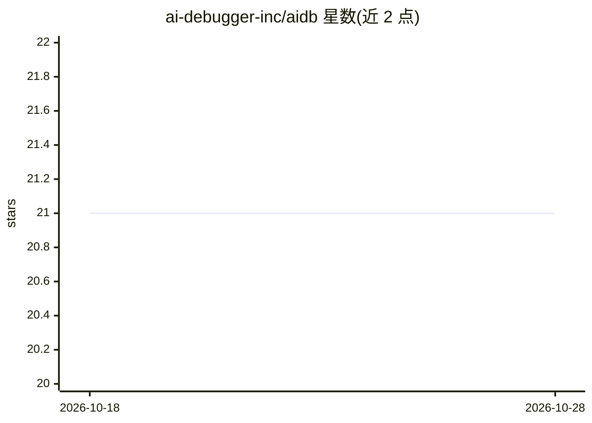

# ai-debugger-inc/aidb

⭐ 21 · Python · Apache-2.0 · 推送 2026-05-12 · [GitHub](https://github.com/ai-debugger-inc/aidb) · [官网](https://ai-debugger.com) · 组织维护

**面向 AI agent 的多语言调试接口（MCP+DAP 桥接）**

AI Debugger (AIDB) 通过 MCP 接口把 Debug Adapter Protocol 生态暴露给 AI agent，使 Claude、GPT 等助手能对 Python、JavaScript/TypeScript、Java 程序下断点、查看执行流、打日志点与运行时改码。它复用 debugpy、vscode-js-debug、java-debug 等 VS Code 同款适配器，适配器二进制在首次运行时自动下载；可直接读取 launch.json 配置，支持 pytest/jest/django 等框架自动检测。以 pip 包提供，无需安装 VS Code。

## 筛选速览

| 维度 | 判定 | 备注 |
|---|---|---|
| AI 角色 | `ai-ecosystem` | LLM/agent 周边工具 |
| 许可风险 | `permissive` | Apache-2.0 |
| 部署形态 | `library` | 以包/库形式分发 |
| 模型依赖 | — | README 未给出锁定关系 |
| 硬件要求 | — | 无带数字的原话,不猜 |
| 安装摩擦 | `medium` | 含编译或系统依赖之一 |
| 成熟度 | — | 结构信号不足 |

## 能力要点

- 通过 MCP 向 AI agent 暴露 DAP 调试能力
- 支持 Python/JavaScript/TypeScript/Java，复用 VS Code 同款调试适配器
- 条件断点、Logpoints、运行时代码修补
- 可直接复用已有 launch.json 调试配置

## 适用场景

- 让 Claude/Cursor 等 MCP 客户端的 AI 助手直接调试代码
- 在无 IDE 的服务器环境用 agent 排查程序问题
- 团队间共享调试配置供 agent 复用

## 场景标签

`编码 Agent` · 领域:编码与开发

## 证据(README 行号)

> L14: AI Debugger (AIDB) brings the proven Debug Adapter Protocol (DAP) ecosystem to
> L125: Protocol ecosystem to AI agents through a clean, agent-optimized MCP interface.

## 星数曲线

2026-10-18 21 → 2026-10-28 21（+0）

---
*卡片 v1 · prompt 1.4 · 生成 2026-10-28 · 置信度 high · 依据 README sha `baa4a04c21be` · [字段定义](../../DATASET.md)*
