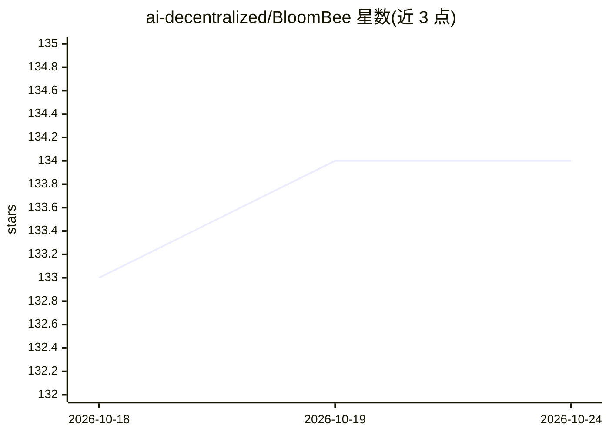

# ai-decentralized/BloomBee

⭐ 134 · Python · Apache-2.0 · 推送 2026-10-21 · [GitHub](https://github.com/ai-decentralized/BloomBee) · 组织维护

**去中心化 P2P 网络上的 LLM 推理系统：跨多台闲置 GPU 分片运行大模型**

BloomBee 将模型的 transformer 层拆分到 P2P 网络中的多个 peer 节点上协同推理：客户端本地运行词嵌入与 LM head，通过 DHT 发现并路由到持有各层的服务器，单卡显存不足的机器可各托管一部分层来共同服务请求。优化手段包括张量卸载、跨互联网投机解码（EAGLE-2）、无损激活压缩与微批流水线。支持 LLaMA/BLOOM/Falcon/Mixtral/Qwen3/GPT-OSS/DeepSeek-V3 等模型，以 pip 包、CLI 与 Python API（兼容 HuggingFace Transformers Auto 类）形式提供；worker 需约 4GB 显存 GPU 与 CUDA 版 PyTorch，客户端可无 GPU。

## 筛选速览

| 维度 | 判定 | 备注 |
|---|---|---|
| AI 角色 | `ai-ecosystem` | LLM/agent 周边工具 |
| 许可风险 | `permissive` | Apache-2.0 |
| 部署形态 | `library` | 以包/库形式分发 |
| 模型依赖 | locked-api |  |
| 硬件要求 | `gpu-8g` | |
| 安装摩擦 | `medium` | 含编译或系统依赖之一 |
| 成熟度 | — | 结构信号不足 |

## 能力要点

- transformer 层跨 P2P peer 分片，DHT 负责层定位与节点发现
- 张量卸载、投机解码（EAGLE-2）、无损激活压缩、微批流水线四类通信优化
- 支持 int8/nf4 量化与 float32/float16/bfloat16 精度
- 提供 HuggingFace 兼容的 AutoDistributed 系列 Auto 类与三个 benchmark 脚本

## 适用场景

- 多台小显存 GPU 机器拼合运行 LLaMA 3.1 (405B) 级别的大模型
- 利用互联网上闲置 GPU 资源组建推理服务网络
- 在异构 NVIDIA GPU 集群上做分布式推理吞吐评测

## 场景标签

`推理引擎` · 领域:训练与推理

## 证据(README 行号)

> L2:  Run large language models in a heterogeneous decentralized environment over internet.
> L6: Instead of requiring a single powerful machine, BloomBee splits a model's transformer blocks across multiple peers i
> L51: A **Distributed Hash Table (DHT)** keeps track of which server hosts which layers. The client automatically discove

## 星数曲线

2026-10-18 133 → 2026-10-24 134（+1）

---
*卡片 v1 · prompt 1.4 · 生成 2026-10-22 · 置信度 high · 依据 README sha `54ab8b492076` · [字段定义](../../DATASET.md)*
