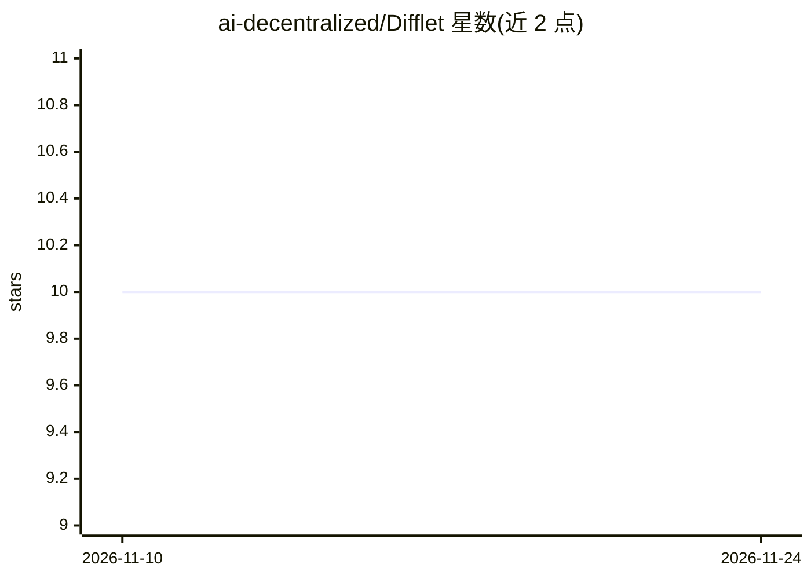

# ai-decentralized/Difflet

⭐ 10 · Python · Apache-2.0 · 推送 2026-11-24 · [GitHub](https://github.com/ai-decentralized/Difflet) · 个人维护

**面向多加速器的扩散 Transformer 推理运行时（CLI/API/服务器）**

统一的扩散 Transformer 推理运行时，覆盖下载、按硬件编译、内容寻址产物缓存与多设备执行三个入口：difflet CLI、OpenAI 兼容 HTTP 服务器、仿 diffusers 的 Python API。通过 backend-neutral 的 difflet.ops 抽象，各加速器（NVIDIA GPU/Trainium/TPU）提供各自实现；支持 TP/CP/SP/CFG-parallel/DP 等并行布局、多 shape 编译缓存、TeaCache 步跳过与 JSONL 批处理。CPU 后端仅用于数值测试与 CI，不用于生成。

## 筛选速览

| 维度 | 判定 | 备注 |
|---|---|---|
| AI 角色 | `ai-ecosystem` | LLM/agent 周边工具 |
| 许可风险 | `permissive` | Apache-2.0 |
| 部署形态 | `None` |  |
| 模型依赖 | — | README 未给出锁定关系 |
| 硬件要求 | — | 无带数字的原话,不猜 |
| 安装摩擦 | `medium` | 含编译或系统依赖之一 |
| 成熟度 | — | 结构信号不足 |

## 能力要点

- 三入口共用一个引擎：CLI、OpenAI 兼容服务器、Python API
- backend-neutral op 层适配 NVIDIA GPU、AWS Trainium（AOT/原生 PyTorch）与实验性 Cloud TPU
- 支持 TP/CP/SP/CFG-parallel/DP 多种并行策略与多 shape 桶化编译缓存
- 支持 FLUX、Qwen-Image、Wan、HunyuanVideo、LTX-2、MiniMax-H3 共 7 个图像/视频模型

## 适用场景

- 在 AWS Trainium 上以 TP/CP 并行批量生成图像与视频
- 通过 OpenAI 兼容服务器常驻提供图像/视频模型服务
- 用 JSONL 批处理在单卡上跑完一批 prompt 请求

## 场景标签

`图像生成` `视频生成` `推理引擎` · 领域:内容生成

## 证据(README 行号)

> L4: **Run diffusion transformers on NVIDIA GPUs, AWS Trainium and (experimentally) Cloud TPU: FLUX, Qwen-Image, Wan, Hun
> L35: Difflet handles the full lifecycle of a diffusion model: model download, compilation where the
> L51: - **`difflet serve`** — a resident, OpenAI-compatible HTTP server for image and video models.

## 星数曲线

2026-11-10 10 → 2026-11-24 10（+0）

---
*卡片 v1 · prompt 1.4 · 生成 2026-11-20 · 置信度 high · 依据 README sha `cbeaf92ca18c` · [字段定义](../../DATASET.md)*
