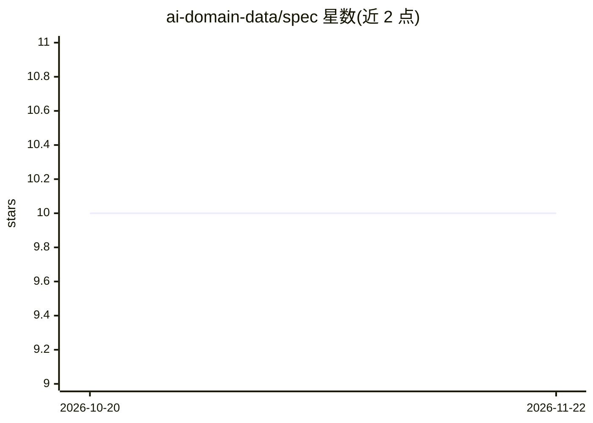

# ai-domain-data/spec

⭐ 10 · JavaScript · MIT · 推送 2025-12-29 · [GitHub](https://github.com/ai-domain-data/spec) · [官网](https://www.ai-domain-data.org/) · 组织维护

**面向 AI 与搜索的开放域名数据格式标准及配套工具**

该仓库维护 AI Domain Data 标准的工作版本（v0.1.1，向后兼容 v0.1）：站点所有者将 JSON 记录自托管在 /.well-known/domain-profile.json，可选用 _ai.<domain> TXT 记录镜像。仓库含规范文本、JSON schema、示例、文档，以及 CLI、Resolver SDK、schema 校验测试套件。另提供官方集成：Next.js、Jekyll、WordPress 插件、GitHub Action 校验器与 Cloudflare Worker，分别用于生成、校验和分发记录。

## 筛选速览

| 维度 | 判定 | 备注 |
|---|---|---|
| AI 角色 | `ai-knowledge` | 知识聚合/清单类 |
| 许可风险 | `permissive` | MIT |
| 部署形态 | `library` | 以包/库形式分发 |
| 模型依赖 | — | README 未给出锁定关系 |
| 硬件要求 | — | 无带数字的原话,不猜 |
| 安装摩擦 | `low` | 无编译、无系统依赖或容器化 |
| 成熟度 | — | 结构信号不足 |

## 能力要点

- 开放、供应商中立的域名权威数据 JSON 格式（.well-known 路径自托管）
- 提供 CLI 与 Resolver SDK 两个官方工具包
- 官方集成覆盖 Next.js/Jekyll/WordPress/GitHub Action/Cloudflare Worker
- 含 schema 校验、示例验证与向后兼容测试套件

## 适用场景

- 为网站发布供 AI 系统与搜索读取的域名权威数据记录
- 给 CMS 或平台开发 domain-profile.json 的一键集成插件
- 在 CI/CD 中校验 domain-profile.json 是否符合 schema

## 场景标签

 · 领域:开放标准/数据格式

## 证据(README 行号)

> L3: This repository houses the v0.1.1 standard (backward-compatible with v0.1), reference tooling, and outreach material
> L43: - `spec/spec/spec-v0.1.md` – Normative spec text for the v0.1.1 release (backward-compatible with v0.1), including 
> L61: Add AI Domain Data support to your site in minutes with our official integrations. Each package handles validation,

## 星数曲线

2026-10-20 10 → 2026-11-22 10（+0）

---
*卡片 v1 · prompt 1.4 · 生成 2026-11-20 · 置信度 mid · 依据 README sha `7d28ae660e58` · [字段定义](../../DATASET.md)*
