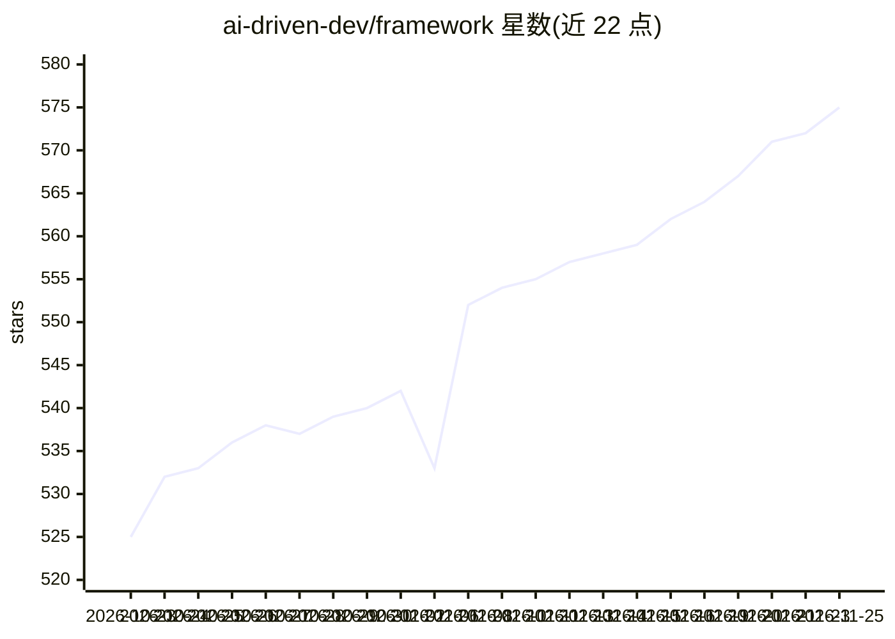

# ai-driven-dev/framework

⭐ 575 · TypeScript · MIT · 推送 2026-11-23 · [GitHub](https://github.com/ai-driven-dev/framework) · [官网](https://www.ai-driven-dev.fr/) · 组织维护

**为开发团队提供标准化 AI 驱动 SDLC 的插件市场框架**

以插件市场形式分发 AI 编码工作流：包含 9 个插件、55 个技能、4 个 agent，覆盖上下文生成与项目记忆、计划/构建/审查/测试/调试、版本控制操作、产品管理文档、头脑风暴与事实核查、以及端到端 SDLC 编排。通过 CLI 安装到用户已有的 AI 编码工具中，兼容 Claude Code、Cursor、GitHub Copilot 等 8 种工具，支持插件市场、扁平文件两种分发形式。需要 Node 22.12 及以上。

## 筛选速览

| 维度 | 判定 | 备注 |
|---|---|---|
| AI 角色 | `ai-ecosystem` | LLM/agent 周边工具 |
| 许可风险 | `permissive` | MIT |
| 部署形态 | `library` | 以包/库形式分发 |
| 模型依赖 | — | README 未给出锁定关系 |
| 硬件要求 | — | 无带数字的原话,不猜 |
| 安装摩擦 | `low` | 无编译、无系统依赖或容器化 |
| 成熟度 | — | 结构信号不足 |

## 能力要点

- 9 个插件、55 个技能、4 个 agent 的 SDLC 插件体系
- 通过 npx CLI 一条命令安装到现有 AI 编码工具
- 兼容 8 种编码工具（Claude Code/Cursor/Copilot 等）
- 插件按 stable/beta/alpha/preview 分级

## 适用场景

- 让 AI 从需求到 PR 端到端交付一个功能
- 为项目建立可复用的 AI 记忆与上下文
- 统一团队的 AI 辅助开发工作流与规范

## 场景标签

`编码 Agent` · 领域:编码与开发

## 证据(README 行号)

> L11:  9 plugins · 55 skills · 4 agents
> L34:  Claude Code ✅ ✅ ✅
> L49: npx @ai-driven-dev/cli@latest setup

## 星数曲线

2026-10-23 525 → 2026-11-25 575（+50）

---
*卡片 v1 · prompt 1.4 · 生成 2026-11-25 · 置信度 high · 依据 README sha `15988b08bf06` · [字段定义](../../DATASET.md)*
