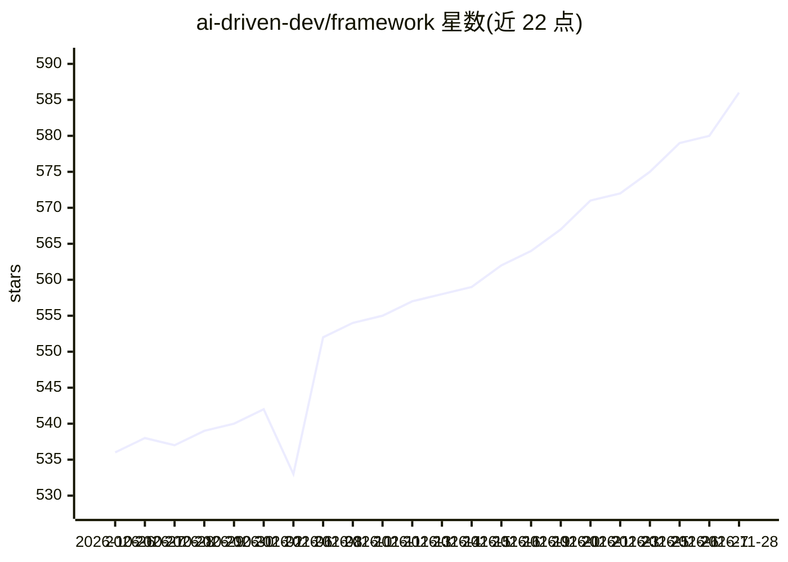

# ai-driven-dev/framework

⭐ 586 · TypeScript · MIT · 推送 2026-11-27 · [GitHub](https://github.com/ai-driven-dev/framework) · [官网](https://www.ai-driven-development.org) · 组织维护

**为工程团队提供标准化 AI 驱动开发工作流的插件框架**

面向使用 AI 编码工具的工程团队，将 SDLC 流程封装为 9 个插件、56 个技能与 4 个 agent：覆盖项目上下文与记忆、计划/构建/评审/测试/调试、版本控制操作、产品文档（Briefs/Epics/Stories）、头脑风暴与事实核查、端到端特性交付编排等。通过 marketplace 或平铺文件安装到 Claude Code、Cursor、GitHub Copilot、Codex 等已有工具中，含 hooks 与 token 用量遥测（opt-in）。要求 Node 22.12+，MIT 许可。

## 筛选速览

| 维度 | 判定 | 备注 |
|---|---|---|
| AI 角色 | `ai-ecosystem` | LLM/agent 周边工具 |
| 许可风险 | `permissive` | MIT |
| 部署形态 | `library` | 以包/库形式分发 |
| 模型依赖 | — | README 未给出锁定关系 |
| 硬件要求 | — | 无带数字的原话,不猜 |
| 安装摩擦 | `low` | 无编译、无系统依赖或容器化 |
| 成熟度 | — | 结构信号不足 |

## 能力要点

- 9 插件 / 56 技能 / 4 agent 的 SDLC 工作流体系
- 兼容 Claude Code、Cursor、GitHub Copilot、Codex 等 8 种工具（marketplace 与平铺文件两种安装形态）
- 项目记忆与上下文生成（aidd-context 插件）
- /aidd-orchestrator:01-sdlc 将技能串联为端到端特性交付流程

## 适用场景

- 让团队在既有 AI 编码工具中统一采用标准化开发流程
- 从需求 Brief 到 PR 评审的端到端特性交付
- 为遗留系统项目建立 AI 可复用的项目记忆与上下文
- 按任务统计 token 用量以控制成本

## 场景标签

`工作流自动化` `编码 Agent` · 领域:效率与自动化

## 证据(README 行号)

> L3: # AI-Driven Dev Framework
> L25: From a rough idea to a reviewed pull request, inside the AI coding tool you already use.
> L31: ## Works with your tool

## 星数曲线

2026-10-26 536 → 2026-11-28 586（+50）

---
*卡片 v1 · prompt 1.4 · 生成 2026-11-27 · 置信度 high · 依据 README sha `28ddb7d2cdbe` · [字段定义](../../DATASET.md)*
