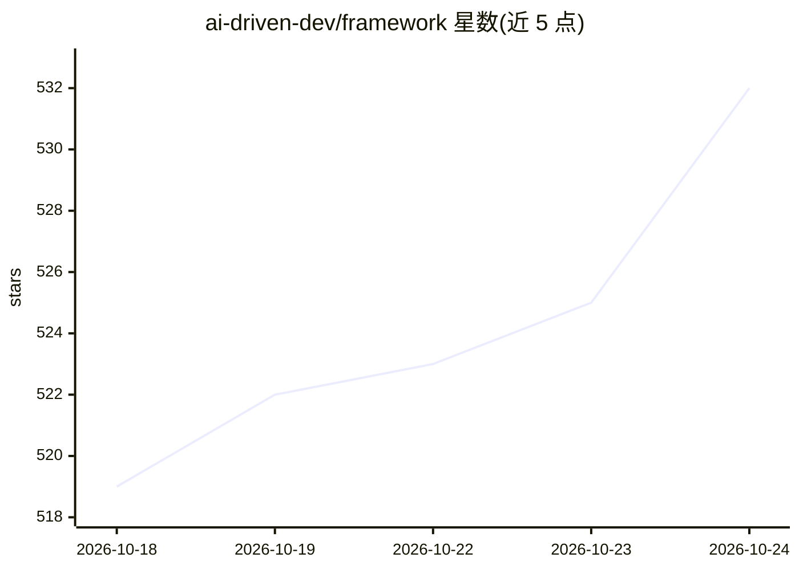

# ai-driven-dev/framework

⭐ 533 · TypeScript · MIT · 推送 2026-10-23 · [GitHub](https://github.com/ai-driven-dev/framework) · [官网](https://www.ai-driven-dev.fr/) · 组织维护

**面向 AI 编码工具的 SDLC 框架：插件/技能/代理标准化开发流程**

将一套软件开发生命周期（skills、agents、commands、rules）安装到 AI 编码工具中的框架，覆盖 9 个插件、51 个技能、2 个代理，把想法经 frame→plan→implement→validate→review→ship 流程转为已评审的 PR。原生支持 Claude Code，另支持 Cursor、GitHub Copilot、Codex、OpenCode、Kilo Code（Marketplace 或 Flat 复制安装）。工作流本体为 markdown，仅含 hooks 的插件需要 Node 22+。aidd-ui 处于 alpha，aidd-telemetry 为 beta。

## 筛选速览

| 维度 | 判定 | 备注 |
|---|---|---|
| AI 角色 | `ai-ecosystem` | LLM/agent 周边工具 |
| 许可风险 | `permissive` | MIT |
| 部署形态 | `None` |  |
| 模型依赖 | — | README 未给出锁定关系 |
| 硬件要求 | — | 无带数字的原话,不猜 |
| 安装摩擦 | `low` | 无编译、无系统依赖或容器化 |
| 成熟度 | `idea` | |

## 能力要点

- 9 个插件 / 51 个技能 / 2 个代理覆盖完整 SDLC
- 支持 6 种 AI 编码工具（Claude Code 原生，其余 Marketplace 或 Flat 安装）
- 工作流为 markdown 文件，无需额外运行时；hooks 插件需 Node 22+
- 自带 token 计数的遥测插件（opt-in、本地存储）

## 适用场景

- 为团队的 AI 编码工具统一标准化开发流程
- 用 /aidd-orchestrator:01-sdlc 端到端交付功能到 PR
- 建立项目记忆库与上下文工程规范

## 场景标签

`编码 Agent` `提示工程` · 领域:Agent 开发

## 证据(README 行号)

> L20: The **AI-Driven Dev Framework** installs a working SDLC (Software Development Life Cycle) into your AI coding tool 
> L31: - **An AI coding tool** — Claude Code (native), or Cursor / Copilot / Codex / OpenCode / Kilo Code (see Compatibili
> L183: Nine plugins covering the whole SDLC — **install the six stable ones**; they work together. (`aidd-ui` is 🚧 **alph

## 星数曲线

2026-10-18 519 → 2026-10-24 532（+13）

---
*卡片 v1 · prompt 1.4 · 生成 2026-10-21 · 置信度 high · 依据 README sha `7a225ebd5d56` · [字段定义](../../DATASET.md)*
