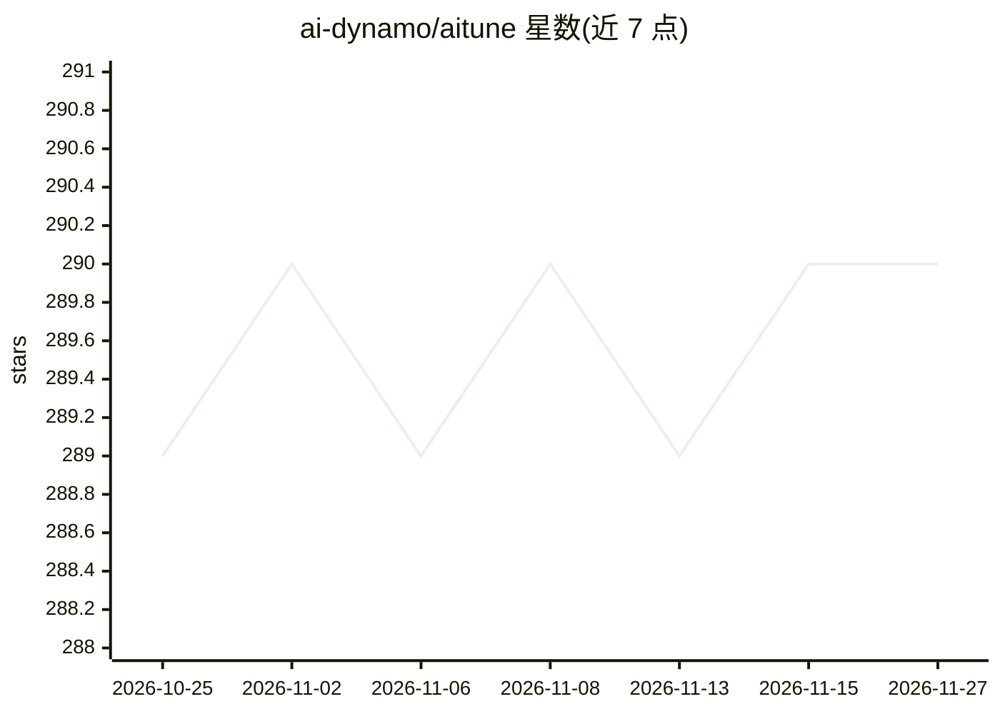

# ai-dynamo/aitune

⭐ 290 · Python · Apache-2.0 · 推送 2026-11-26 · [GitHub](https://github.com/ai-dynamo/aitune) · [官网](https://docs.nvidia.com/aitune) · 组织维护

**面向开发者的 PyTorch 模型推理调优与部署工具包**

NVIDIA AITune 自动化 PyTorch 模型与流水线在 NVIDIA GPU 上的推理调优：inspect、wrap、tune、run/deploy 四阶段工作流，按模块评估后端候选（含 PTQ、kernel 选择、CUDA graphs），依据数值校验与性能测量选择实现。支持 JIT 调优（运行中启用）与 AOT 调优（生成 .ait 工件），可部署至 Triton 或 Dynamo。需 Linux 环境与 NVIDIA GPU，兼容的 PyTorch/CUDA 安装。

## 筛选速览

| 维度 | 判定 | 备注 |
|---|---|---|
| AI 角色 | `ai-ecosystem` | LLM/agent 周边工具 |
| 许可风险 | `permissive` | Apache-2.0 |
| 部署形态 | `library` | 以包/库形式分发 |
| 模型依赖 | — | README 未给出锁定关系 |
| 硬件要求 | — | 无带数字的原话,不猜 |
| 安装摩擦 | `medium` | 含编译或系统依赖之一 |
| 成熟度 | — | 结构信号不足 |

## 能力要点

- 单一 API 整合多后端评估、数值校验与性能测量
- JIT 运行中调优与 AOT 生成可复用 .ait 工件两种模式
- 流水线中不同模块可用不同后端
- 生成 Triton 模型仓库或经 Dynamo worker 部署

## 适用场景

- 为 Stable Diffusion 等模型寻找更快的推理后端
- 调优后的模块保存为工件用于部署
- 按吞吐/延迟/延迟预算策略自动选择后端实现

## 场景标签

`推理引擎` · 领域:训练与推理

## 证据(README 行号)

> L7: **NVIDIA AITune automates inference tuning for PyTorch models and pipelines on NVIDIA GPUs.**
> L8: It brings inference engines and acceleration techniques together under a single, extensible API. AITune combines
> L26: - **Prepare for deployment.** Reuse tuned modules in Python, generate Triton model repositories, or serve through

## 星数曲线

2026-10-25 289 → 2026-11-27 290（+1）

---
*卡片 v1 · prompt 1.4 · 生成 2026-11-26 · 置信度 high · 依据 README sha `6865a60552f1` · [字段定义](../../DATASET.md)*
