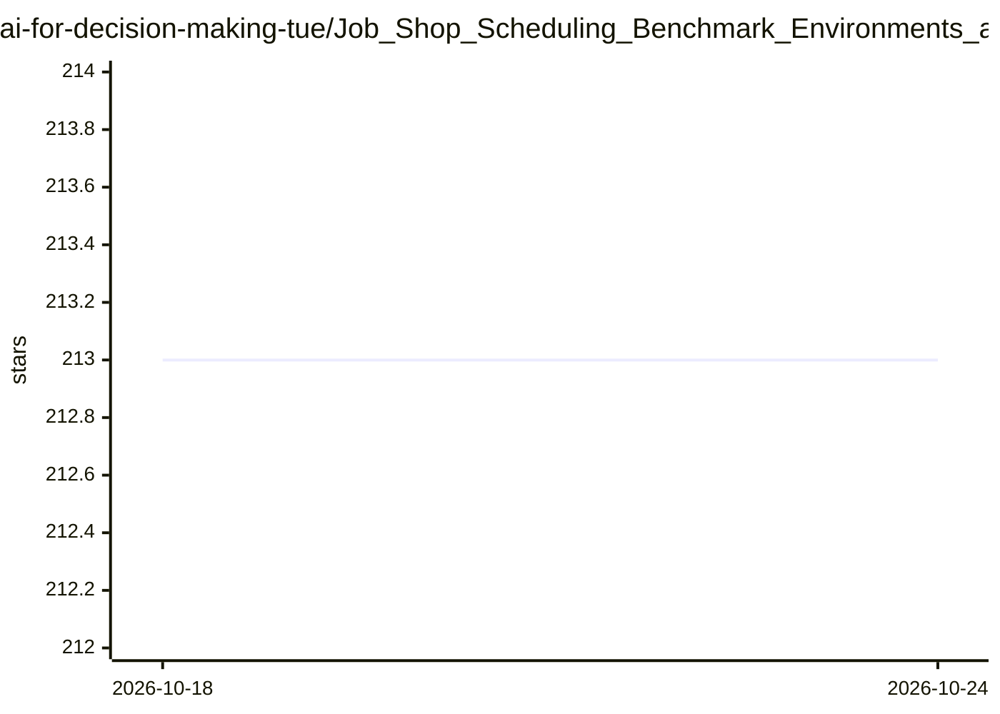

# ai-for-decision-making-tue/Job_Shop_Scheduling_Benchmark_Environments_and_Instances

⭐ 214 · Jupyter Notebook · MIT · 推送 2026-09-24 · [GitHub](https://github.com/ai-for-decision-making-tue/Job_Shop_Scheduling_Benchmark_Environments_and_Instances) · 组织维护

**面向研究者的多种机器调度问题基准环境与算例集**

提供 JSP、FSP、FJSP、带装配约束/序列相关调整时间的 FJSP 及在线 FJSP 等多种机器调度问题的统一基准环境与算例集。收录精确方法（MILP、CP-SAT）、启发式方法（调度规则、遗传算法）与深度强化学习方法（L2D、FJSP-DRL、DANIEL），各方法与问题变体的兼容性以矩阵列出。仓库含配置、算例数据与解析器、甘特图与优先约束可视化、支持在线到达作业的仿真环境，面向科研人员做调度算法评测，配有论文与教程链接。限制：README 未给出安装命令。

## 筛选速览

| 维度 | 判定 | 备注 |
|---|---|---|
| AI 角色 | `ai-ecosystem` | LLM/agent 周边工具 |
| 许可风险 | `permissive` | MIT |
| 部署形态 | `None` |  |
| 模型依赖 | — | README 未给出锁定关系 |
| 硬件要求 | — | 无带数字的原话,不猜 |
| 安装摩擦 | `low` | 无编译、无系统依赖或容器化 |
| 成熟度 | — | 结构信号不足 |

## 能力要点

- 覆盖 JSP/FSP/FJSP/FAJSP/FJSP-SDST/在线 FJSP 多种调度问题变体
- 精确、启发式与 DRL 三类共 7 种求解方法及兼容矩阵
- 算例数据集与解析器、仿真环境（含在线到达作业）
- 优先约束关系与甘特图绘制功能

## 适用场景

- 统一环境下对比调度算法在多类调度问题上的表现
- 获取带装配约束或调整时间等变体的标准算例做评测
- 为 DRL 调度方法提供训练与基准测试环境

## 场景标签

`模型评测` `科研工具` `强化学习` · 领域:评测与运维

## 证据(README 行号)

> L7: This repository provides a comprehensive benchmarking environment for a variety of machine scheduling problems, incl
> L10: The repository includes exact, heuristic and learning based solution methods, each compatible with one or more mach

## 星数曲线

2026-10-18 213 → 2026-10-24 213（+0）

---
*卡片 v1 · prompt 1.4 · 生成 2026-10-22 · 置信度 high · 依据 README sha `112e48fe4ef7` · [字段定义](../../DATASET.md)*
