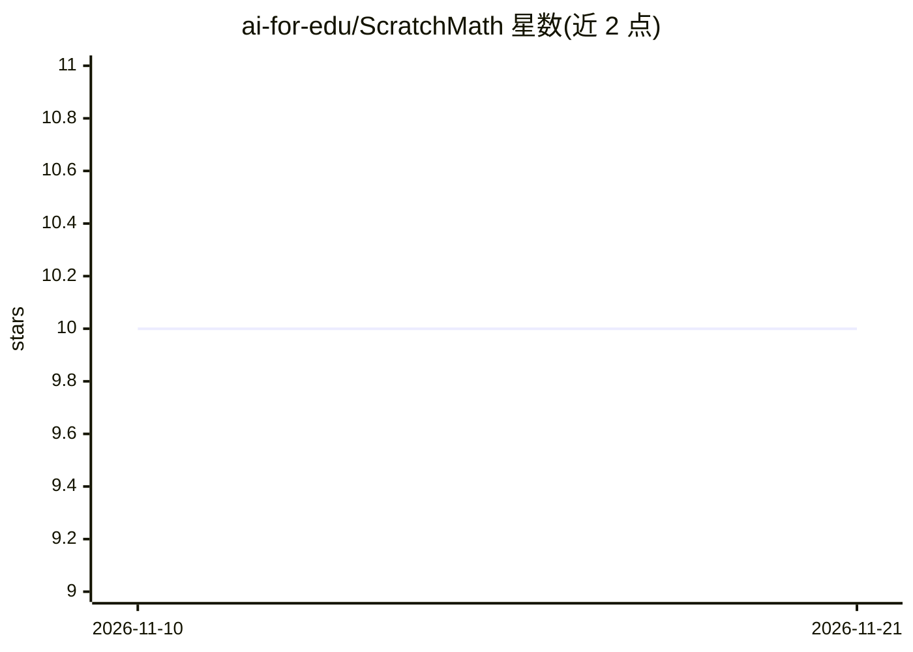

# ai-for-edu/ScratchMath

⭐ 10 · Python · NOASSERTION · 推送 2026-03-27 · [GitHub](https://github.com/ai-for-edu/ScratchMath) · 组织维护 · 中文 README

**评测 MLLM 诊断学生手写数学草稿错误的论文与基准数据集**

ScratchMath 是一篇 AIED 2026 论文的官方仓库，附基准数据集与评测代码。任务为错误诊断：给定题目、正确答案、参考解、学生错误答案与手写草稿图像，模型需生成错误原因解释（ECE）或将错误归入 7 类之一（ECC）。数据来自中国中小学生，共 1,720 样本（小学 1,479、初中 241），人机协作标注；评测了 16 个 MLLM，ECE 采用 LLM-as-a-Judge（o3-mini）评分。提供 HuggingFace 数据集加载、基于 vLLM 的开源模型评测流程。许可为 CC BY-NC-SA 4.0。

## 筛选速览

| 维度 | 判定 | 备注 |
|---|---|---|
| AI 角色 | `ai-knowledge` | 知识聚合/清单类 |
| 许可风险 | `none` | NOASSERTION |
| 部署形态 | `library` | 以包/库形式分发 |
| 模型依赖 | local-ok | 支持本地模型 |
| 硬件要求 | — | 无带数字的原话,不猜 |
| 安装摩擦 | `low` | 无编译、无系统依赖或容器化 |
| 成熟度 | — | 结构信号不足 |

## 能力要点

- 1,720 个真实学生手写草稿样本（小学 1,479 / 初中 241）
- 两个互补任务：错误原因解释（ECE）与 7 类错误原因分类（ECC）
- 对 16 个 MLLM 基准评测并附排行榜
- ECE 指标采用 LLM-as-a-Judge（o3-mini，88.6% 人一致性）

## 适用场景

- 研究 MLLM 对学生手写数学草稿的错误诊断能力
- 为 AI 教育评测加载 songdj/ScratchMath 数据集
- 复现论文中的 ECE/ECC 评测流程

## 场景标签

`模型评测` · 领域:评测与运维

## 证据(README 行号)

> L41: **ScratchMath** evaluates whether Multimodal Large Language Models (MLLMs) can analyze handwritten mathematical scr
> L65: The dataset is hosted on HuggingFace: **songdj/ScratchMath**
> L109: ```

## 星数曲线



2026-11-10 10 → 2026-11-21 10（+0）


---
*卡片 v1 · prompt 1.4 · 生成 2026-11-20 · 置信度 high · 依据 README sha `7e0b0b343c5f` · [字段定义](../../DATASET.md)*
