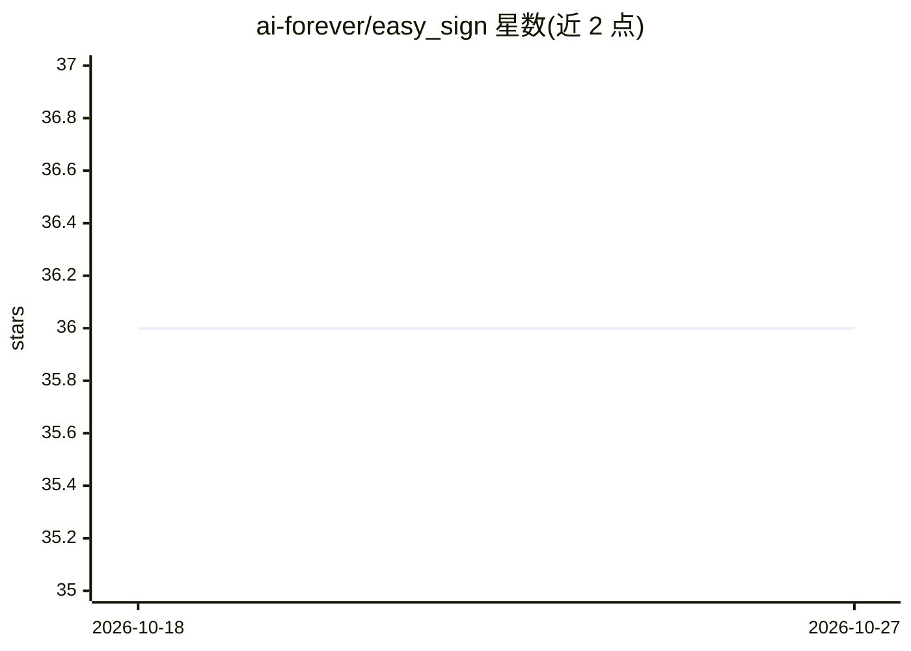

# ai-forever/easy_sign

⭐ 36 · Python · CC-BY-SA-4.0 · 推送 2026-09-01 · [GitHub](https://github.com/ai-forever/easy_sign) · [官网](https://habr.com/ru/companies/sberbank/articles/775688/) · 组织维护

**俄语手语识别开源项目：轻量 CPU 模型 + Streamlit 部署**

ai-forever（Sber）团队的俄语手语单个手势识别项目：使用在约 18 万个手势样本（其中约 2 万来自 Slovo 数据集）上训练的轻量 ML 模型，识别 1598 个俄语手语手势，在 Intel i5-6600 CPU 上可达每秒 3-3.5 个手势的识别速度，无需 GPU。通过 conda 环境 + pip 安装依赖、streamlit run 启动 Web 界面部署使用，另在 Hugging Face 提供 S3D 模型权重（不同帧数版本，准确率 44%-56%）。

## 筛选速览

| 维度 | 判定 | 备注 |
|---|---|---|
| AI 角色 | `ai-native` | 本体是模型或模型工具 |
| 许可风险 | `viral` | CC-BY-SA-4.0 |
| 部署形态 | `library` | 以包/库形式分发 |
| 模型依赖 | — | README 未给出锁定关系 |
| 硬件要求 | — | 无带数字的原话,不猜 |
| 安装摩擦 | `low` | 无编译、无系统依赖或容器化 |
| 成熟度 | — | 结构信号不足 |

## 能力要点

- 识别 1598 个俄语手语手势，类别清单存于 RSL_class_list.txt
- 轻量模型可在 CPU 上运行（Intel i5-6600 上约 3-3.5 手势/秒）
- 基于约 18 万样本训练，其中约 2 万来自 Slovo 数据集
- Streamlit Web 界面部署，Hugging Face 提供 S3D ONNX 权重

## 适用场景

- 在普通 CPU 设备上部署俄语手语手势识别演示
- 俄语手语学习或交流辅助应用的原型开发
- 下载 S3D 预训练权重用于俄语手语相关研究实验

## 场景标签

`图像视频处理` · 领域:感知与多模态

## 证据(README 行号)

> L6: Easy_sign использует ML-модель для распознавания отдельных жестов Русского жестового языка.
> L8: Модель распознаёт 1598 жестов Русского жестового языка и может обеспечить распознавание 3-3.5 жестов в секунду на пр

## 星数曲线

2026-10-18 36 → 2026-10-27 36（+0）

---
*卡片 v1 · prompt 1.4 · 生成 2026-10-25 · 置信度 mid · 依据 README sha `0e844704b11d` · [字段定义](../../DATASET.md)*
