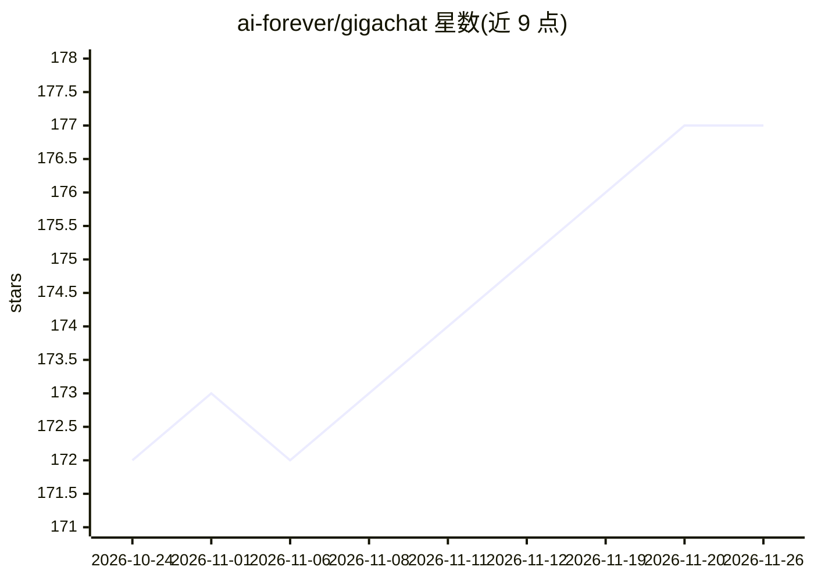

# ai-forever/gigachat

⭐ 177 · Python · MIT · 推送 2026-11-06 · [GitHub](https://github.com/ai-forever/gigachat) · 组织维护

**GigaChat 大模型 REST API 的 Python SDK**

面向接入 GigaChat LLM 服务的开发者提供的 Python SDK，封装 chat/completions 的同步/异步与流式调用，并覆盖 embeddings、function calling、多模态视觉、文件上传与 token 计数等 API 能力。支持 OAuth、密码、TLS 证书、access token 四种认证方式，带自动重试与 Pydantic V2 类型定义。当前分支为 0.3.0a1 alpha 预发布，API 可能变动；要求 Python 3.10+，3.8/3.9 需停留在 0.2.x。该库属于 GigaChain，并作为 langchain-gigachat 集成的基础。

## 筛选速览

| 维度 | 判定 | 备注 |
|---|---|---|
| AI 角色 | `ai-ecosystem` | LLM/agent 周边工具 |
| 许可风险 | `permissive` | MIT |
| 部署形态 | `library` | 以包/库形式分发 |
| 模型依赖 | — | README 未给出锁定关系 |
| 硬件要求 | — | 无带数字的原话,不猜 |
| 安装摩擦 | `medium` | 含编译或系统依赖之一 |
| 成熟度 | `idea` | |

## 能力要点

- 同步/异步 chat completions 与流式响应
- embeddings、function calling、视觉多模态与文件操作
- 四种认证方式（OAuth/密码/TLS 证书/access token）
- Pydantic V2 全类型标注与可配置指数退避重试

## 适用场景

- 在 Python 应用中调用 GigaChat 模型生成对话与流式输出
- 用 function calling 构建调用 GigaChat 的 agent
- 对文本生成向量表示用于检索场景

## 场景标签

 · 领域:LLM 基础设施/SDK

## 证据(README 行号)

> L9: Python SDK for the GigaChat REST API — a large language model.
> L11: This library is part of GigaChain and powers langchain-gigachat, the official LangChain integration for GigaChat.
> L31: pip install gigachat

## 星数曲线

2026-10-24 172 → 2026-11-26 177（+5）

---
*卡片 v1 · prompt 1.4 · 生成 2026-11-26 · 置信度 high · 依据 README sha `77e98d326a60` · [字段定义](../../DATASET.md)*
