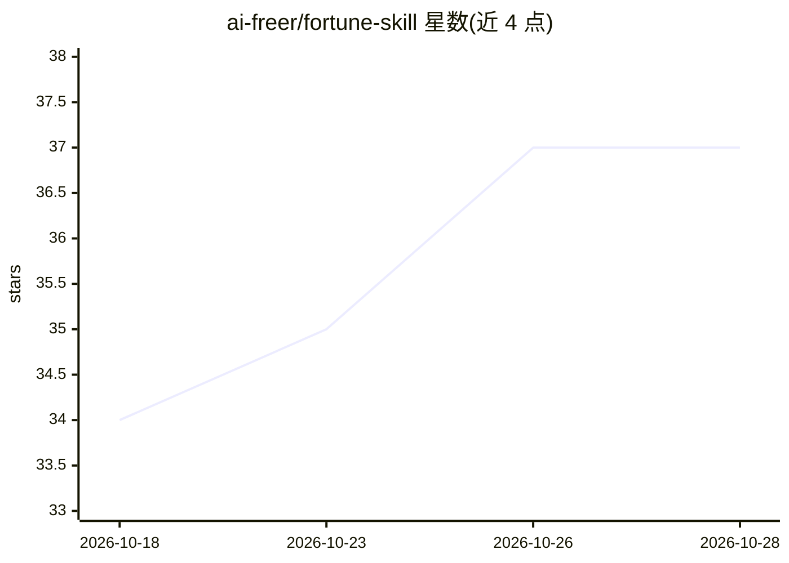

# ai-freer/fortune-skill

⭐ 37 · JavaScript · NOASSERTION · 推送 2026-05-07 · [GitHub](https://github.com/ai-freer/fortune-skill) · 个人维护 · 中文 README

**给 agent 平台的中国传统命理分析技能（八字+紫微斗数）**

面向 Claude Code / Codex / Cursor / Trae / OpenClaw 等 agent 平台的命理分析 Skill：用户通过自然语言对话提供出生信息，脚本完成真太阳时校正与八字/紫微排盘（Layer 1 精确计算输出 JSON），agent 读取 references/ 中的经典典籍做综合分析与报告生成（Layer 3）。集成 china-testing/bazi 经典论断，提供报告聚合、合参判断卡片、QA 与隐私检查等 npm 脚本。通过 exec 调用命令行脚本工作，无需 MCP 或 HTTP 服务。许可为 PolyForm Noncommercial，仅限非商用，非 OSI 开源协议。

## 筛选速览

| 维度 | 判定 | 备注 |
|---|---|---|
| AI 角色 | `ai-native` | 本体是模型或模型工具 |
| 许可风险 | `none` | NOASSERTION |
| 部署形态 | `library` | 以包/库形式分发 |
| 模型依赖 | — | README 未给出锁定关系 |
| 硬件要求 | — | 无带数字的原话,不猜 |
| 安装摩擦 | `low` | 无编译、无系统依赖或容器化 |
| 成熟度 | — | 结构信号不足 |

## 能力要点

- 三层计算架构：脚本精确排盘输出 JSON，典籍知识注入，LLM 综合分析
- 真太阳时校正：出生地必填，自动处理夏令时与县区别名归属
- 支持 OpenClaw / Claude Code / Codex / Cursor / Trae 等 agent 平台，零服务集成（exec 调用）
- 报告流水线：结构化合参卡片、规则命中、QA 检查与隐私自查脚本

## 适用场景

- 在 Claude Code 或 Codex 等工具里通过对话算八字、看紫微、查运势、合婚
- 生成含证据节点与置信度拆解的结构化命理报告
- 研究中国传统命理的 agent 技能实现方式

## 场景标签

 · 领域:中国传统文化/命理分析

## 证据(README 行号)

> L33: 为 OpenClaw agent 构建一个中国传统命理分析 Skill，支持紫微斗数和八字命理两大体系。用户通过自然语言对话提供出生信息，系统自动排盘并结合经典典籍进行专业分析。
> L91: Layer 1 保证排盘精确（LLM 自己算干支会出错），Layer 2 提供系统化的专业知识，Layer 3 发挥 LLM 的综合分析和表达能力。
> L261: Agent 读取 references/ 中的典籍规则，结合三份排盘数据，按 SKILL.md 定义的分析框架输出：

## 星数曲线

2026-10-18 34 → 2026-10-28 37（+3）

---
*卡片 v1 · prompt 1.4 · 生成 2026-10-25 · 置信度 mid · 依据 README sha `9cedac7e22d2` · [字段定义](../../DATASET.md)*
