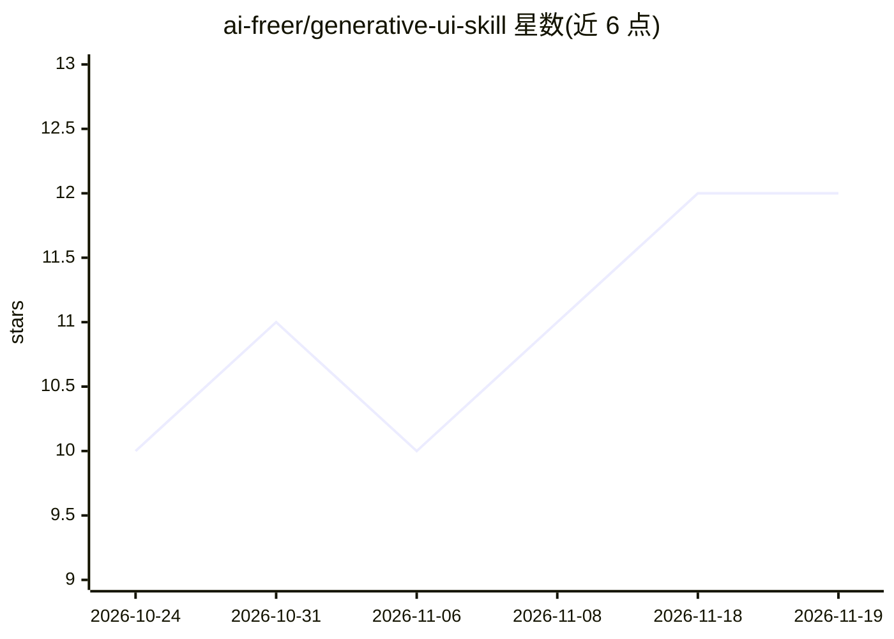

# ai-freer/generative-ui-skill

⭐ 12 · HTML · Apache-2.0 · 推送 2026-10-18 · [GitHub](https://github.com/ai-freer/generative-ui-skill) · 个人维护 · 中文 README

**给任意 LLM 聊天机器人添加生成式 UI 的 Prompt skill 与渲染器**

项目将 Claude.ai 的生成式 UI 能力抽象为通用 skill：通过系统提示词让模型在 show-widget 代码围栏中输出 HTML/SVG 组件，配合框架无关的 JavaScript 渲染运行时（npm 包 generative-ui-renderer）完成流式检测、两阶段 HTML 消毒、沙箱 iframe 执行与交互桥接。不依赖特定 SDK，任何能输出 Markdown 的模型均可驱动。渠道适配层将组件截图为 PNG 并映射到飞书/Telegram/QQ 原生按钮；渠道场景对模型指令遵循能力要求较高，项目处于维护模式。

## 筛选速览

| 维度 | 判定 | 备注 |
|---|---|---|
| AI 角色 | `ai-ecosystem` | LLM/agent 周边工具 |
| 许可风险 | `permissive` | Apache-2.0 |
| 部署形态 | `library` | 以包/库形式分发 |
| 模型依赖 | — | README 未给出锁定关系 |
| 硬件要求 | — | 无带数字的原话,不猜 |
| 安装摩擦 | `low` | 无编译、无系统依赖或容器化 |
| 成熟度 | — | 结构信号不足 |

## 能力要点

- 代码围栏代替 tool_use，任何能输出 Markdown 的模型可驱动
- 三段式渲染管线：流式预览、沙箱 iframe 隔离、交互桥接
- 内置六类设计指南模块（core/diagram/chart/interactive/mockup/art）按需加载
- Telegram/飞书/QQ 渠道适配：组件截图为 PNG 并映射原生按钮

## 适用场景

- 为已有聊天机器人添加图表、架构图、计算器等交互组件输出
- 在飞书/Telegram/QQ 群机器人中展示可视化内容
- 自托管本地 Playground 测试不同模型的 UI 生成效果
- 在自有 Web 应用中直接集成 widget-renderer 渲染组件

## 场景标签

`提示工程` · 领域:Agent 开发

## 证据(README 行号)

> L22: The goal of this project is to abstract that capability into a **general-purpose skill**, so every chatbot and AI a
> L54: - **Code fences instead of `tool_use`** - No dependency on a specific SDK. Any model that can emit Markdown can dri
> L79: `generative-ui-renderer` is a framework-agnostic JavaScript library currently in M2 development. Once included in a

## 星数曲线

2026-10-24 10 → 2026-11-19 12（+2）

---
*卡片 v1 · prompt 1.4 · 生成 2026-11-18 · 置信度 mid · 依据 README sha `8a4802f03a60` · [字段定义](../../DATASET.md)*
