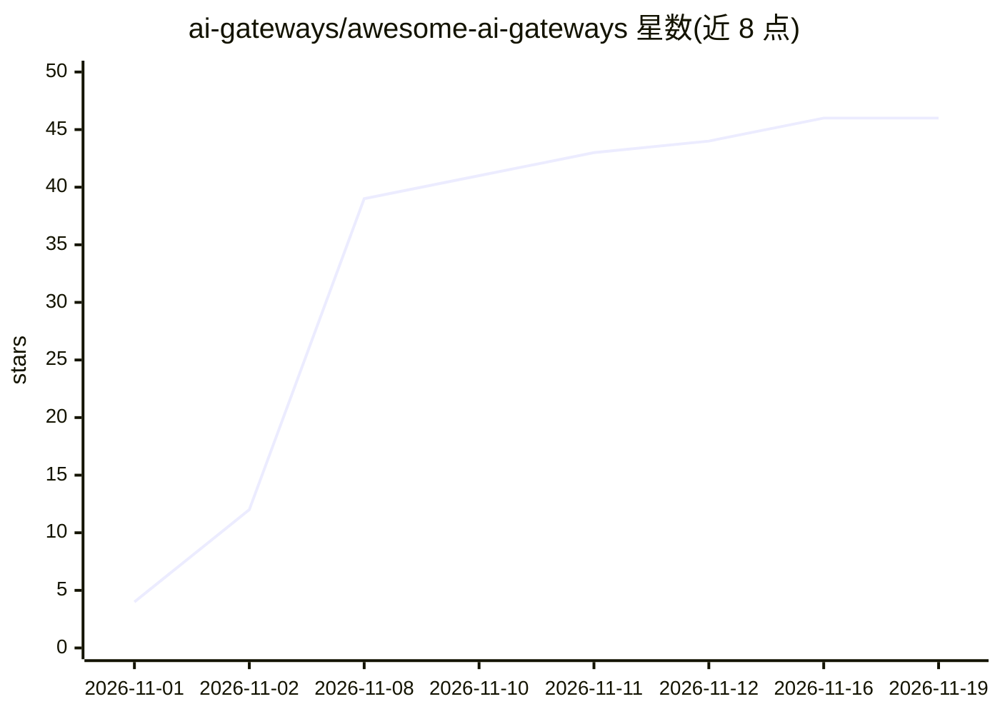

# ai-gateways/awesome-ai-gateways

⭐ 46 · CC0-1.0 · 推送 2026-11-16 · [GitHub](https://github.com/ai-gateways/awesome-ai-gateways) · 个人维护

**AI 网关开源与商业产品策展清单（LLM/MCP/A2A）**

面向 AI 网关选型的 awesome 类清单：收录开源与商业的 LLM 网关、MCP 网关、A2A agent 网关、带 AI 功能的通用 API 网关，以及相关规范与选型指南。条目按类别组织、类别内字母排序，每条标注许可证与主要实现语言，Proprietary 标记付费商业产品；说明部分概述了网关在应用与模型/MCP 工具/agent 之间承担路由、访问控制、花费限额、护栏与日志的定位。

## 筛选速览

| 维度 | 判定 | 备注 |
|---|---|---|
| AI 角色 | `ai-knowledge` | 知识聚合/清单类 |
| 许可风险 | `viral` | CC0-1.0 |
| 部署形态 | `None` |  |
| 模型依赖 | — | README 未给出锁定关系 |
| 硬件要求 | — | 无带数字的原话,不猜 |
| 安装摩擦 | `low` | 无编译、无系统依赖或容器化 |
| 成熟度 | — | 结构信号不足 |

## 能力要点

- 覆盖 LLM、MCP、A2A、通用 API 网关四类条目及规范与指南
- 每条标注许可证、实现语言或 Proprietary 标记
- 类别内按字母排序，含跨类别重复能力的交叉说明

## 适用场景

- 为团队选型 LLM/MCP 网关时查找候选产品
- 比较开源与商业 AI 网关的许可证与实现语言
- 了解网关在路由、访问控制、预算与日志方面的职能划分

## 场景标签

`精选清单` · 领域:学习与行业

## 证据(README 行号)

> L3: > AI gateways sit between applications and the models, MCP tools, and agents they call, and apply routing, access co
> L5: Open source and commercial gateways for LLM, MCP, and agent-to-agent (A2A) traffic, the specifications they implemen

## 星数曲线

2026-11-01 4 → 2026-11-19 46（+42）

---
*卡片 v1 · prompt 1.4 · 生成 2026-11-18 · 置信度 high · 依据 README sha `597c338b993e` · [字段定义](../../DATASET.md)*
