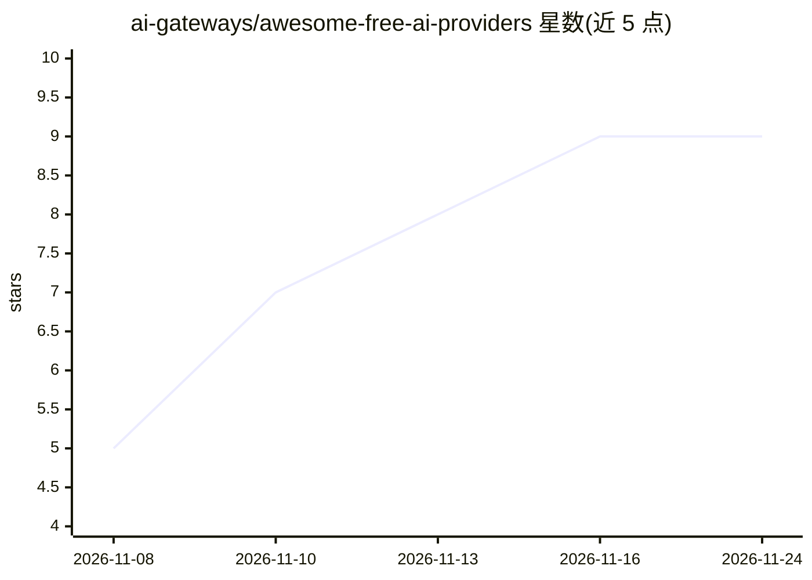

# ai-gateways/awesome-free-ai-providers

⭐ 9 · CC0-1.0 · 推送 2026-11-03 · [GitHub](https://github.com/ai-gateways/awesome-free-ai-providers) · 个人维护

**托管 AI 模型 API 免费额度清单：额度、限制与数据条款**

收录各托管 AI 模型 API 的免费层、免费模型与注册赠金的清单，每条目列出额度上限、注册要求、速率限制（RPM/RPD/TPM 等口径）及免费层数据是否可用于训练，均链接到服务商官方页面并标注核查日期。按字母分节组织，汇总可公开计量的免费层（合计约 5,850 万 tokens/月）与一次性赠金（约 1.175 亿 tokens），并提供在多服务商前置 OpenAI 兼容网关（如 Bifrost）做故障转移的指引。免费政策变动频繁，条目按 2026 年 11 月快照维护。

## 筛选速览

| 维度 | 判定 | 备注 |
|---|---|---|
| AI 角色 | `ai-knowledge` | 知识聚合/清单类 |
| 许可风险 | `viral` | CC0-1.0 |
| 部署形态 | `None` |  |
| 模型依赖 | — | README 未给出锁定关系 |
| 硬件要求 | — | 无带数字的原话,不猜 |
| 安装摩擦 | `low` | 无编译、无系统依赖或容器化 |
| 成熟度 | — | 结构信号不足 |

## 能力要点

- 约 52 家服务商的免费层/赠金汇总，含卡片要求与 OpenAI 兼容性标注
- 区分永久免费层、免费模型、注册赠金三类免费形式
- 可计量免费层合计约 5,850 万 tokens/月，附逐家计算依据
- 每条目注明数据使用条款与最后核查日期

## 适用场景

- 为零预算项目挑选可用的免费 LLM API
- 搭建多服务商 fallback 网关前比较各家速率限制
- 评估免费层数据是否会用于模型训练

## 场景标签

`精选清单` · 领域:学习与行业

## 证据(README 行号)

> L3: > Many hosted AI model APIs can be used at no cost through a permanent free tier, free models, or a signup credit, e
> L5: What each provider gives away, where the limits are, what you need to sign up, and whether free-tier prompts may be 
> L92: ## Free Tiers

## 星数曲线

2026-11-08 5 → 2026-11-24 9（+4）

---
*卡片 v1 · prompt 1.4 · 生成 2026-11-20 · 置信度 high · 依据 README sha `d9195ddc5a26` · [字段定义](../../DATASET.md)*
