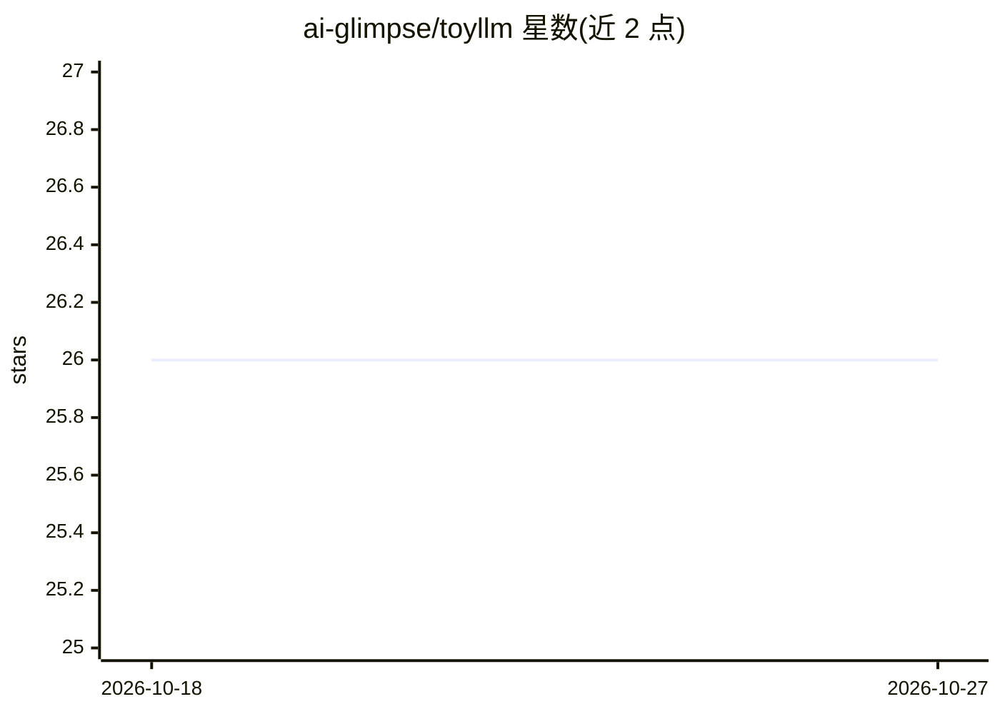

# ai-glimpse/toyllm

⭐ 26 · Python · Apache-2.0 · 推送 2026-10-26 · [GitHub](https://github.com/ai-glimpse/toyllm) · [官网](https://ai-glimpse.github.io/toyllm/) · 个人维护

**从零实现学习 LLM 的教育项目：GPT-2 训练与推理**

面向 LLM 学习者的动手教学项目：以带类型标注的 Python 实现 GPT-2（支持训练与推理），并附三项推理技术实现——可配置草稿模型与性能基准的 speculative sampling、面向长序列的 KV cache 优化版本，以及对应 benchmark 工具。通过 CLI 模块运行各功能，模型文件从 Hugging Face 仓库以 Git LFS 获取。环境要求 Python 3.14，推荐使用 uv 管理依赖，从源码 git clone 安装，无打包发布形式。

## 筛选速览

| 维度 | 判定 | 备注 |
|---|---|---|
| AI 角色 | `ai-native` | 本体是模型或模型工具 |
| 许可风险 | `permissive` | Apache-2.0 |
| 部署形态 | `None` |  |
| 模型依赖 | — | README 未给出锁定关系 |
| 硬件要求 | — | 无带数字的原话,不猜 |
| 安装摩擦 | `low` | 无编译、无系统依赖或容器化 |
| 成熟度 | — | 结构信号不足 |

## 能力要点

- 带类型标注的 GPT-2 训练与推理实现
- speculative sampling 实现（可配置草稿模型、含基准测试）
- KV cache 优化的长序列推理版本
- CLI 入口覆盖推理与 benchmark 场景

## 适用场景

- 学习 transformer 架构与 GPT-2 的具体实现
- 理解并实验 speculative sampling 推理加速
- 对比 KV cache 优化前后的推理性能

## 场景标签

`教程课程` · 领域:学习与行业

## 证据(README 行号)

> L3: A hands-on educational project for understanding and implementing Large Language Models (LLMs) from scratch. This pr
> L8: A clean, educational implementation of GPT-2 with type hints, supporting both training and inference.
> L53: uv run python -m toyllm.cli.run_gpt2 --help  # View available options

## 星数曲线

2026-10-18 26 → 2026-10-27 26（+0）

---
*卡片 v1 · prompt 1.4 · 生成 2026-10-26 · 置信度 high · 依据 README sha `1d12cdc85456` · [字段定义](../../DATASET.md)*
