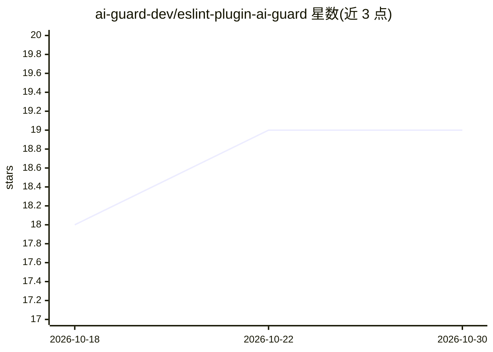

# ai-guard-dev/eslint-plugin-ai-guard

⭐ 19 · TypeScript · MIT · 推送 2026-10-24 · [GitHub](https://github.com/ai-guard-dev/eslint-plugin-ai-guard) · [官网](https://getaiguard.dev) · 组织维护

**检测 AI 辅助代码缺陷模式的 ESLint 插件与 CI 守护工具**

面向 JavaScript/TypeScript 项目的 ESLint 插件（eslint-plugin-ai-guard），基于 ESLint 原生 AST 引擎提供 18 条确定性规则，分安全、可靠性、异步稳定性、AI 模式四类，检测硬编码密钥、空 catch、浮动 Promise、缺失路由鉴权、死分支等 AI 辅助开发常见缺陷；提供 recommended/strict/security/agent 四种预设。除编辑器插件外，还提供零配置 CLI（含 changed/integrity/baseline 等命令）、GitHub Action（SARIF 2.1.0）、Claude Code hooks 与 MCP server。注意其自述不是 AI 检测器，也不替代 ESLint。

## 筛选速览

| 维度 | 判定 | 备注 |
|---|---|---|
| AI 角色 | `ai-ecosystem` | LLM/agent 周边工具 |
| 许可风险 | `permissive` | MIT |
| 部署形态 | `library` | 以包/库形式分发 |
| 模型依赖 | — | README 未给出锁定关系 |
| 硬件要求 | — | 无带数字的原话,不猜 |
| 安装摩擦 | `low` | 无编译、无系统依赖或容器化 |
| 成熟度 | — | 结构信号不足 |

## 能力要点

- 18 条 AST 确定性规则 + 4 种预设（recommended/strict/security/agent）
- integrity 命令检测削弱检查的变更（新增抑制、删除测试、降低配置）
- Claude Code hooks 集成与本地 STDIO MCP server
- GitHub Action 原生输出 SARIF 2.1.0 接入 Code Scanning

## 适用场景

- 在编辑器与 CI 中拦截 AI 助手生成的安全隐患与异步缺陷
- Claude Code 等 agent 编辑工作流中实时反馈 lint 结果
- 安全审计时仅启用 security 预设扫描 6 条安全规则

## 场景标签

`代码审查` · 领域:编码与开发

## 证据(README 行号)

> L26: **AI Guard** (`eslint-plugin-ai-guard`) provides:
> L31: - **Claude Code integration** with hooks that send findings back to Claude and block finishing once when checks wer
> L34: It is engineered to detect reliability bugs, async hazards, security vulnerabilities, and code-scaffolding defects 

## 星数曲线

2026-10-18 18 → 2026-10-30 19（+1）

---
*卡片 v1 · prompt 1.4 · 生成 2026-10-28 · 置信度 high · 依据 README sha `7f72b11c6700` · [字段定义](../../DATASET.md)*
