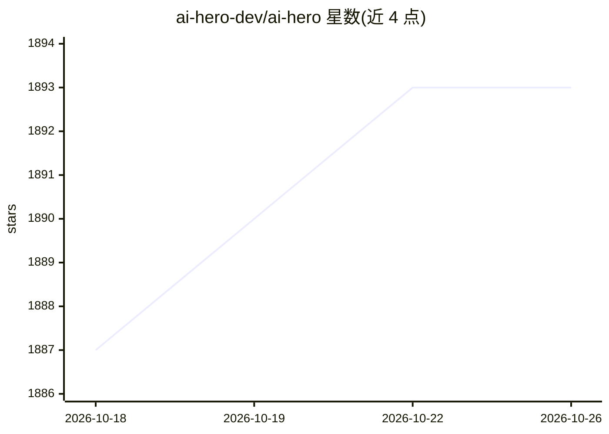

# ai-hero-dev/ai-hero

⭐ 1,893 · TypeScript · NOASSERTION · 推送 2026-08-06 · [GitHub](https://github.com/ai-hero-dev/ai-hero) · [官网](https://www.aihero.dev/) · 个人维护

**AI 工程课程的开源示例与练习代码仓库**

AI Hero 课程的配套开源仓库，面向想从前端/后端/全栈转入 AI 工程的开发者，收录课程示例、练习、库与 SDK（如评测框架 Evalite）及文章。每个示例为独立可运行的代码片段并链接到对应讲解文章。运行需要 Node.js（推荐 LTS）与 pnpm，通过 pnpm 安装依赖，在 .env 中配置 OpenAI 或 Anthropic API key 后用 pnpm run example 运行；README 提到将补充本地模型运行指南。

## 筛选速览

| 维度 | 判定 | 备注 |
|---|---|---|
| AI 角色 | `ai-knowledge` | 知识聚合/清单类 |
| 许可风险 | `none` | NOASSERTION |
| 部署形态 | `library` | 以包/库形式分发 |
| 模型依赖 | — | README 未给出锁定关系 |
| 硬件要求 | — | 无带数字的原话,不猜 |
| 安装摩擦 | `low` | 无编译、无系统依赖或容器化 |
| 成熟度 | — | 结构信号不足 |

## 能力要点

- 示例目录中每个示例均为独立可运行的代码样例
- 开源课程代码含库与 SDK（如评测框架 Evalite）
- 配置 OpenAI 或 Anthropic API key 二选一即可运行示例

## 适用场景

- 跟随示例从零学习 AI 工程开发
- 参考可运行的代码样例理解 AI SDK 用法
- 订阅课程动态跟踪新增示例

## 场景标签

`教程课程` · 领域:学习与行业

## 证据(README 行号)

> L7: AI Hero is the course I'm building to take you from **zero to fully-fledged AI engineer**.
> L24: Each example is a self-contained, runnable code sample that demonstrates a concept or technique.

## 星数曲线

2026-10-18 1,887 → 2026-10-26 1,893（+6）

---
*卡片 v1 · prompt 1.4 · 生成 2026-10-21 · 置信度 mid · 依据 README sha `20b06e42a78e` · [字段定义](../../DATASET.md)*
