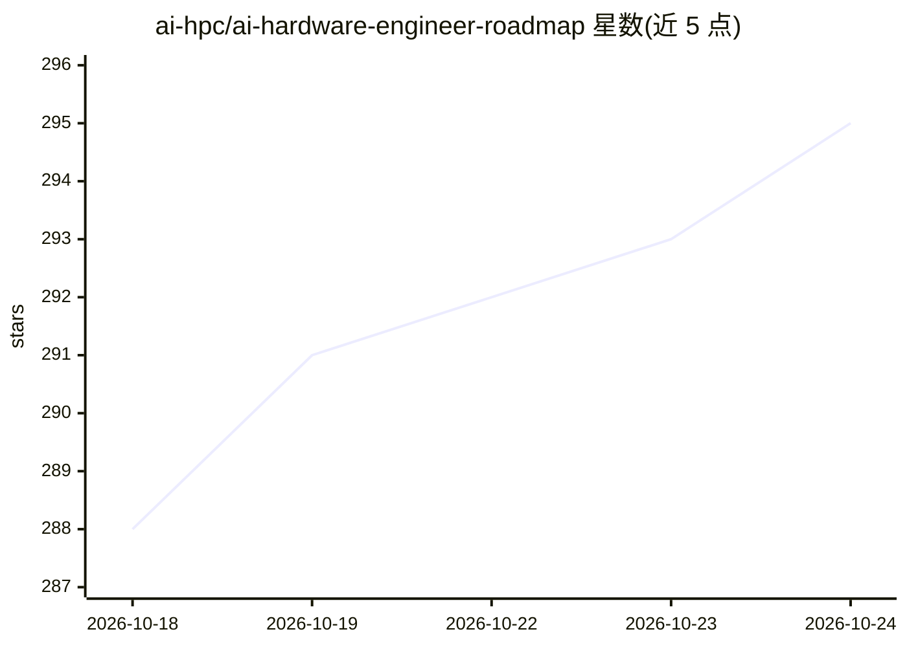

# ai-hpc/ai-hardware-engineer-roadmap

⭐ 295 · Python · MIT · 推送 2026-10-23 · [GitHub](https://github.com/ai-hpc/ai-hardware-engineer-roadmap) · [官网](https://ai-hpc.github.io/ai-hardware-engineer-roadmap/) · 个人维护

**面向 AI 硬件工程师的学习路线图：从模型到自研 SoC**

一份结构化课程路线图，目标是让工程师掌握从模型工作负载到自定义物理 AI 系统级芯片（SoC）的全栈能力：VLA 模型推理、AI 编译器与运行时、RTL/FPGA/ASIC 设计、嵌入式 Linux 与无线子系统。内容分六个阶段与三条支柱，提供四种入门路径（推理、编译器、硬件、机器人）、按里程碑推进的设计工作室、多门带 CPU 实验的课程（如 32 讲 VLA 课程、10 讲可编程推理加速器课程）。面向 AI/ML、推理、嵌入式固件、RTL/FPGA 与机器人工程师及学生，无硬件背景要求。

## 筛选速览

| 维度 | 判定 | 备注 |
|---|---|---|
| AI 角色 | `ai-knowledge` | 知识聚合/清单类 |
| 许可风险 | `permissive` | MIT |
| 部署形态 | `None` |  |
| 模型依赖 | — | README 未给出锁定关系 |
| 硬件要求 | — | 无带数字的原话,不猜 |
| 安装摩擦 | `medium` | 含编译或系统依赖之一 |
| 成熟度 | — | 结构信号不足 |

## 能力要点

- 六阶段课程：数字基础→嵌入式→AI→部署编译→专业化→面试准备
- 统一目标为设计面向 VLA 模型的自定义物理 AI SoC（含加速器、编译器、嵌入式 Linux、无线）
- 四种入门路径均产出可验证的子系统里程碑
- 提供带可运行 CPU 实验的专业课程与 Isaac Sim/Isaac Lab 工程实验

## 适用场景

- 系统学习从 AI 模型到芯片设计的完整技术栈
- 为转做 AI 加速器/SoC 设计规划学习路径
- 机器人工程师补齐计算平台底层知识

## 场景标签

`教程课程` · 领域:学习与行业

## 证据(README 行号)

> L11: Six phases toward one goal: a complete physical-AI chip and its software stack.
> L41: - **AI/ML engineers** who want to stop treating inference as a black box and design the chip that runs it.

## 星数曲线

2026-10-18 288 → 2026-10-24 295（+7）

---
*卡片 v1 · prompt 1.4 · 生成 2026-10-22 · 置信度 high · 依据 README sha `5439cee3aefc` · [字段定义](../../DATASET.md)*
