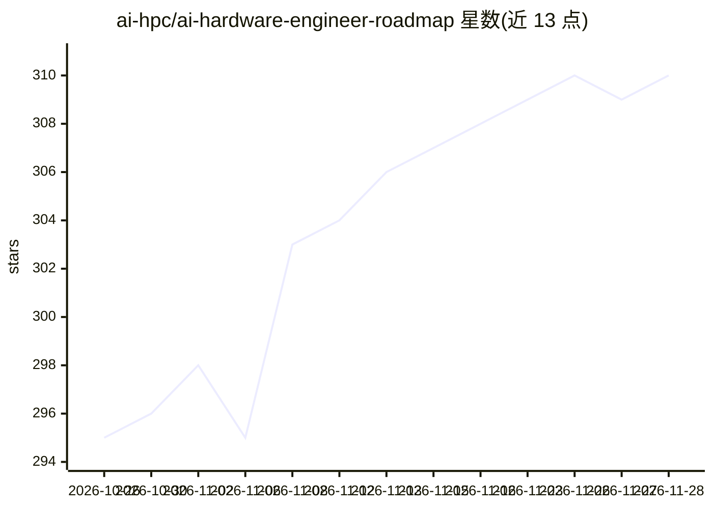

# ai-hpc/ai-hardware-engineer-roadmap

⭐ 310 · Python · MIT · 推送 2026-11-27 · [GitHub](https://github.com/ai-hpc/ai-hardware-engineer-roadmap) · [官网](https://ai-hpc.github.io/ai-hardware-engineer-roadmap/) · 组织维护

**面向工程师的 AI 硬件全栈学习路线图：从模型到自研芯片**

一份分六个阶段的学习路线图与课程集，目标是让学习者从 AI 模型工作负载出发，最终设计一个面向视觉-语言-动作（VLA）模型的物理 AI SoC，涵盖 AI 加速器、AI 编译器与运行时、嵌入式 Linux 与无线子系统集成。路线图提供四种入口（AI 推理、编译器/运行时、硬件工程、机器人学习）、入门诊断、硬件获取选项与共享完成标准；初学者可先在笔记本上完成十个引导实验。软件与硬件背景者均可按需跳过前置阶段。

## 筛选速览

| 维度 | 判定 | 备注 |
|---|---|---|
| AI 角色 | `ai-knowledge` | 知识聚合/清单类 |
| 许可风险 | `permissive` | MIT |
| 部署形态 | `None` |  |
| 模型依赖 | — | README 未给出锁定关系 |
| 硬件要求 | — | 无带数字的原话,不猜 |
| 安装摩擦 | `medium` | 含编译或系统依赖之一 |
| 成熟度 | — | 结构信号不足 |

## 能力要点

- 六阶段路线：数字基础→嵌入式→AI→部署与编译→专精→面试准备
- 四种入口路径连接至同一 SoC 设计目标，各入口产出独立子系统
- Physical AI Design Studio 项目链：VLA 参考→仿真→推理测量→编译器→加速器→Linux→无线
- 含 DeepSeek V4.1 Flash NVFP4 推理工程与 Isaac Sim/Lab 应用课程序列

## 适用场景

- 推理工程师想理解模型到硬件的完整执行路径
- 嵌入式/FPGA 工程师想按真实模型负载设计加速器
- 机器人方向学生想搭建从模型到执行的完整计算平台

## 场景标签

`教程课程` · 领域:学习与行业

## 证据(README 行号)

> L9: ## Explore the curriculum
> L11: Six phases toward one goal: a complete physical-AI chip and its software stack.
> L55: Follow the **Physical AI Design Studio** to connect the courses through one project: task contract → VLA reference 

## 星数曲线

2026-10-26 295 → 2026-11-28 310（+15）

---
*卡片 v1 · prompt 1.4 · 生成 2026-11-25 · 置信度 high · 依据 README sha `66fdacdfa7b7` · [字段定义](../../DATASET.md)*
