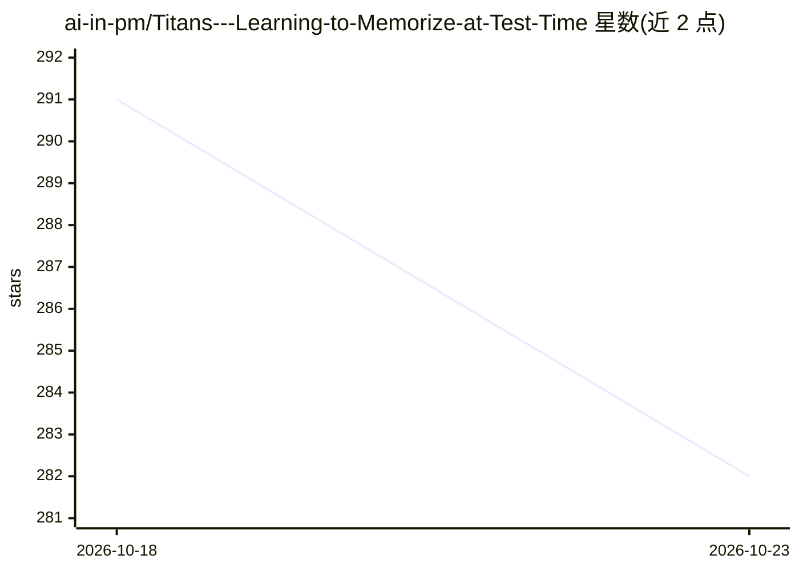

# ai-in-pm/Titans---Learning-to-Memorize-at-Test-Time

⭐ 282 · Python · MIT · 推送 2026-06-15 · [GitHub](https://github.com/ai-in-pm/Titans---Learning-to-Memorize-at-Test-Time) · 个人维护

**Titans 论文的多 agent 交互演示桌面平台**

为 arXiv:2501.00663 Titans 架构（测试时学习记忆的神经网络）打造的交互演示平台：7 个 agent 分别对应 OpenAI GPT-4、Anthropic Claude、Mistral、Groq、Gemini、Cohere、Emergence，各自从神经记忆模块、Memory as Context/Gate/Layer 等角色探讨同一记忆问题。提供 Tkinter 原生桌面界面，含实时遥测、流式输出、图表与跨 agent 综合分析。仅需任一 API key 即可运行，缺失 provider 的 agent 显示不可用状态；Windows 提供 titans.bat/exe 启动方式。

## 筛选速览

| 维度 | 判定 | 备注 |
|---|---|---|
| AI 角色 | `ai-native` | 本体是模型或模型工具 |
| 许可风险 | `permissive` | MIT |
| 部署形态 | `desktop` | 安装包/桌面程序 |
| 模型依赖 | locked-api |  |
| 硬件要求 | — | 无带数字的原话,不猜 |
| 安装摩擦 | `low` | 无编译、无系统依赖或容器化 |
| 成熟度 | — | 结构信号不足 |

## 能力要点

- 7 个 agent 分别接入 7 家 LLM provider，角色对应 Titans 架构组件
- Tkinter 桌面界面：agent 选择、实时遥测、token 用量指标、数值序列图表
- 仅配置任一 API key 即可运行，未配置的 agent 优雅降级
- 包含 MAC/MAG/MAL 三种记忆整合方式的科普说明与论文引用

## 适用场景

- 直观理解 Titans 论文的记忆架构与三种整合方式
- 对比不同 LLM 对同一记忆问题的推理过程
- 作为测试时学习（test-time learning）概念的交互教学演示

## 场景标签

 · 领域:深度学习/论文演示

## 证据(README 行号)

> L9: **An interactive multi-agent demonstration platform for the landmark *Titans* architecture — the first neural networ
> L17: - **7 specialized AI agents**, each embodying a different perspective on the Titans architecture
> L39: |1|**Neural Memory Module**|OpenAI (GPT-4)|Core long-term memory model|

## 星数曲线

2026-10-18 291 → 2026-10-23 282（-9）

---
*卡片 v1 · prompt 1.4 · 生成 2026-10-22 · 置信度 high · 依据 README sha `fb98589dcdd7` · [字段定义](../../DATASET.md)*
