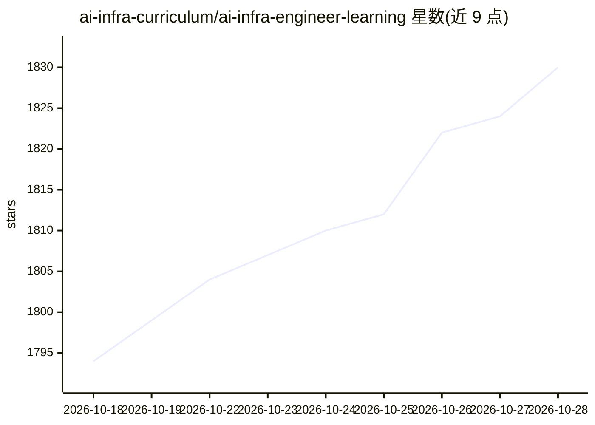

# ai-infra-curriculum/ai-infra-engineer-learning

⭐ 1,830 · Python · MIT · 推送 2026-06-26 · [GitHub](https://github.com/ai-infra-curriculum/ai-infra-engineer-learning) · 组织维护

**面向工程师的 AI 基础设施生产级学习路径（10 模块+3 项目）**

AI Career Curriculum 生态下的开源课程仓库：以 10 个模块（共 500+ 小时）覆盖云平台、Docker、Kubernetes、数据管道、MLOps、GPU 计算、监控、IaC 与 LLM 基础设施，配 3 个实战项目（模型服务、MLOps 管道、LLM 部署平台）与 265+ 道测验题。面向有 2-4 年经验、已完成初级课程或具备 Python/Linux/K8s 基础的学习者；通过 git clone 获取，练习解答放在配对 solutions 仓库。2026 年更新中对完成度声明做了逐模块核算修正。

## 筛选速览

| 维度 | 判定 | 备注 |
|---|---|---|
| AI 角色 | `ai-knowledge` | 知识聚合/清单类 |
| 许可风险 | `permissive` | MIT |
| 部署形态 | `self-host` | docker 或自建部署 |
| 模型依赖 | — | README 未给出锁定关系 |
| 硬件要求 | — | 无带数字的原话,不猜 |
| 安装摩擦 | `low` | 无编译、无系统依赖或容器化 |
| 成熟度 | — | 结构信号不足 |

## 能力要点

- 10 模块 207 文件约 95,000+ 行，覆盖基础设施到 LLM 部署
- 3 个生产级项目（模型服务/MLOps 管道/LLM 部署平台）
- 模块 102-110 配 265+ 道测验题
- 提供高级与 Staff 工程师两条延伸阅读路径

## 适用场景

- 系统学习从容器编排到 LLM 推理服务的 ML 基础设施技能
- 按模块测验自检云、Kubernetes、MLOps 掌握程度
- 通过三个实战项目积累生产部署经验

## 场景标签

`教程课程` `MLOps` · 领域:学习与行业

## 证据(README 行号)

> L18: This repository contains a **complete, production-ready learning path** for becoming an **AI Infrastructure Enginee
> L70: ### 10 Complete Learning Modules (130 Files)
> L72: |Module|Topic|Hours|Status|Quiz|

## 星数曲线

2026-10-18 1,794 → 2026-10-28 1,830（+36）

---
*卡片 v1 · prompt 1.4 · 生成 2026-10-21 · 置信度 mid · 依据 README sha `7d8f5bc67866` · [字段定义](../../DATASET.md)*
