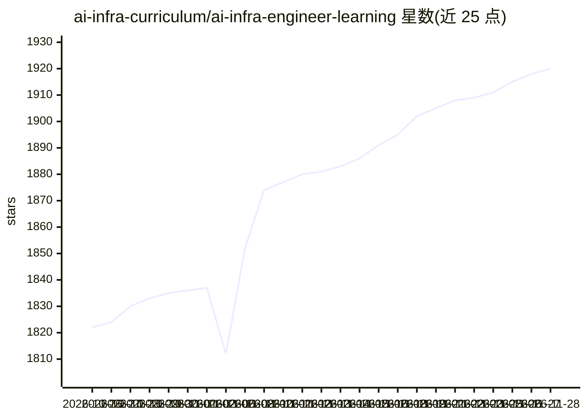

# ai-infra-curriculum/ai-infra-engineer-learning

⭐ 1,920 · Python · MIT · 推送 2026-11-03 · [GitHub](https://github.com/ai-infra-curriculum/ai-infra-engineer-learning) · 组织维护

**面向工程师的 AI 基础设施学习课程（10 模块 500+ 小时）**

面向有 2-4 年经验工程师的开源 AI 基础设施学习路径：10 个模块各 50 小时，覆盖云计算、容器化、Kubernetes、数据管道、MLOps、GPU 训练、监控、IaC 与 LLM 基础设施；含 62 个实验、265+ 道测验题与 3 个实战项目（模型服务、MLOps 管道、LLM 部署平台），配套练习解答在独立仓库中。入门要求 Python 3.9+、Linux CLI、Git、Docker/K8s 基础与 ML 基础知识。

## 筛选速览

| 维度 | 判定 | 备注 |
|---|---|---|
| AI 角色 | `ai-knowledge` | 知识聚合/清单类 |
| 许可风险 | `permissive` | MIT |
| 部署形态 | `self-host` | docker 或自建部署 |
| 模型依赖 | — | README 未给出锁定关系 |
| 硬件要求 | — | 无带数字的原话,不猜 |
| 安装摩擦 | `low` | 无编译、无系统依赖或容器化 |
| 成熟度 | — | 结构信号不足 |

## 能力要点

- 10 个学习模块共 130 个文件，约 500 小时学习内容
- 62 个可运行实验与 265+ 道模块测验题
- 3 个生产级项目：模型服务、MLOps 管道、LLM 部署平台
- 学习材料声明可在云服务免费额度内完成

## 适用场景

- 系统学习从 Docker/K8s 到 LLM 推理基础设施的工程技能
- 准备 AI 基础设施工程师岗位所需的技术栈
- 按实验步骤搭建模型服务与 MLOps 流水线练手

## 场景标签

`教程课程` · 领域:学习与行业

## 证据(README 行号)

> L18: This repository contains a **complete, production-ready learning path** for becoming an **AI Infrastructure Enginee
> L38: - 🚀 **Progressive**: 10 modules building from basics to advanced LLM infrastructure
> L48: - 🧪 **All 62 promised labs authored** across all 10 modules (foundations → LLM infrastructure). Each lab is a subst

## 星数曲线

2026-10-26 1,822 → 2026-11-28 1,920（+98）

---
*卡片 v1 · prompt 1.4 · 生成 2026-11-23 · 置信度 mid · 依据 README sha `fa7a7aec9cea` · [字段定义](../../DATASET.md)*
