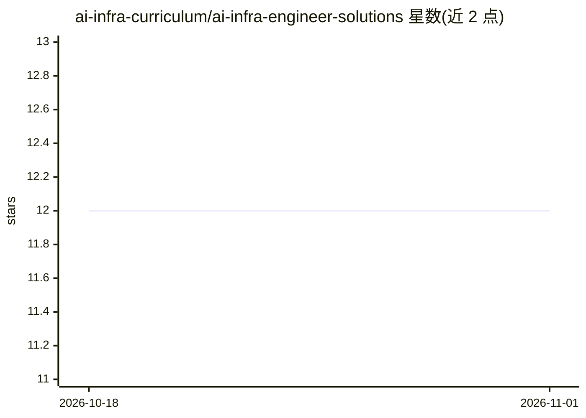

# ai-infra-curriculum/ai-infra-engineer-solutions

⭐ 12 · Python · MIT · 推送 2026-10-29 · [GitHub](https://github.com/ai-infra-curriculum/ai-infra-engineer-solutions) · 组织维护

**AI 基础设施工程师课程的 119 个项目参考答案仓库**

AI Career Curriculum 生态中 Engineer 轨道的解决方案仓库：为 10 个模块（云计算、容器化、Kubernetes、MLOps、GPU、LLM 基础设施等）共 119 个练习提供可运行的参考实现，含完整代码、分步指南、Docker/Kubernetes 配置、测试套件与 Prometheus/Grafana 监控。面向自学者对照实现、讲师用作教材、招聘方用作技术评估基线。前置要求 Python 3.11+、Docker 24.0+、Kubernetes 集群。

## 筛选速览

| 维度 | 判定 | 备注 |
|---|---|---|
| AI 角色 | `ai-knowledge` | 知识聚合/清单类 |
| 许可风险 | `permissive` | MIT |
| 部署形态 | `self-host` | docker 或自建部署 |
| 模型依赖 | — | README 未给出锁定关系 |
| 硬件要求 | — | 无带数字的原话,不猜 |
| 安装摩擦 | `low` | 无编译、无系统依赖或容器化 |
| 成熟度 | — | 结构信号不足 |

## 能力要点

- 119 个练习 100% 覆盖参考解决方案（10 个模块）
- 每个项目含 Docker 多阶段构建、Kubernetes 清单与 CI/CD 管道
- 模块级 SOLUTION.md 设计理由文档与常见错误说明
- CI 含 kubectl dry-run、terraform validate 等运行时校验门

## 适用场景

- 自学者实现项目后对照参考答案与分步讲解
- 讲师用作课程材料与演示范例
- 招聘方将项目作为候选人技术评估基线

## 场景标签

`教程课程` · 领域:学习与行业

## 证据(README 行号)

> L3: > 🎓 Part of the free, open-source **AI Career Curriculum** ecosystem — Infrastructure · ML Engineering · AI Engineer
> L7: > **Complete implementations and step-by-step guides for all AI Infrastructure Engineer projects**
> L40: All 119 learning exercises across all 10 modules now have reference solutions. Working

## 星数曲线

2026-10-18 12 → 2026-11-01 12（+0）

---
*卡片 v1 · prompt 1.4 · 生成 2026-11-01 · 置信度 high · 依据 README sha `f49abab6a4c1` · [字段定义](../../DATASET.md)*
