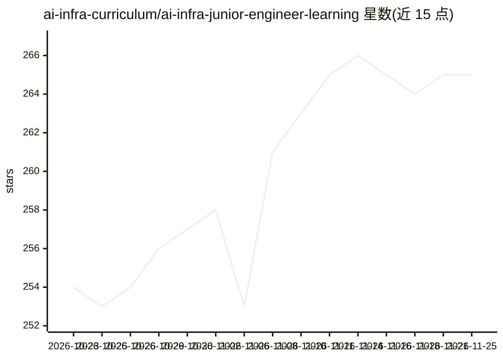

# ai-infra-curriculum/ai-infra-junior-engineer-learning

⭐ 265 · Python · MIT · 推送 2026-11-23 · [GitHub](https://github.com/ai-infra-curriculum/ai-infra-junior-engineer-learning) · 组织维护

**面向 0-2 年经验者的 AI/ML 基础设施工程师入门课程**

一套免费开源的初级 AI 基础设施工程师学习课程：440 小时（10 个模块 + 5 个实战项目），覆盖 Python、Linux、Git、Docker、Kubernetes、MLflow、DVC、Airflow、Prometheus/Grafana 及 AWS/GCP/Azure 云部署与 CI/CD。提供评分量表（70 分及格）、自学/教学/学习小组三种使用路径，以及进阶课程路线图与配套题解仓库。前提为基本 Python 与命令行技能，MIT 许可，由 VeriSwarm.ai 维护。

## 筛选速览

| 维度 | 判定 | 备注 |
|---|---|---|
| AI 角色 | `ai-knowledge` | 知识聚合/清单类 |
| 许可风险 | `permissive` | MIT |
| 部署形态 | `library` | 以包/库形式分发 |
| 模型依赖 | — | README 未给出锁定关系 |
| 硬件要求 | — | 无带数字的原话,不猜 |
| 安装摩擦 | `low` | 无编译、无系统依赖或容器化 |
| 成熟度 | — | 结构信号不足 |

## 能力要点

- 440 小时课程：10 个模块（约 150 小时）+ 5 个项目（约 290 小时）
- 每个项目附 100 分评分量表、自评清单与同伴评审指南
- 项目覆盖模型 API 部署、Kubernetes 交付、ML 管道、监控告警与生产级 capstone
- 提供面向教师的一学期课程结构（16 周）与学习路径建议

## 适用场景

- 作为初学者自学进入 ML 基础设施/MLOps 岗位
- 教师拿来做一学期的 ML 基础设施课程材料
- 学习小组按模块组织讨论与结对编程
- 构建可展示的项目作品集求职

## 场景标签

`教程课程` · 领域:学习与行业

## 证据(README 行号)

> L11: Welcome to the **Junior AI Infrastructure Engineer Learning Repository**! This comprehensive curriculum is designed
> L60: ### Learning Modules (10 modules, ~150 hours)
> L75: ### Hands-On Projects (5 projects, ~290 hours)

## 星数曲线

2026-10-23 254 → 2026-11-25 265（+11）

---
*卡片 v1 · prompt 1.4 · 生成 2026-11-25 · 置信度 mid · 依据 README sha `cb88dd424b7a` · [字段定义](../../DATASET.md)*
