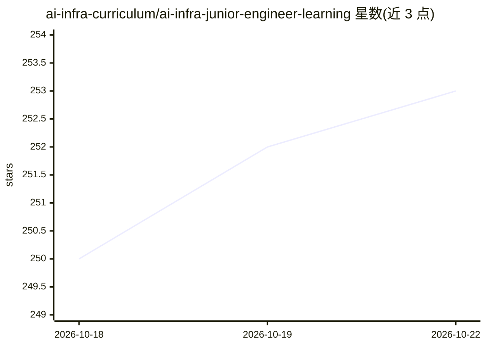

# ai-infra-curriculum/ai-infra-junior-engineer-learning

⭐ 253 · Python · MIT · 推送 2026-07-08 · [GitHub](https://github.com/ai-infra-curriculum/ai-infra-junior-engineer-learning) · 组织维护

**初级 AI 基础设施工程师的系统化课程仓库（440 小时）**

面向 0-2 年经验入门者的 AI/ML 基础设施课程：10 个学习模块（约 150 小时）覆盖 Python、Linux、Git、ML 基础、Docker、Kubernetes、API、数据库、监控与云平台；5 个实操项目（约 290 小时）从模型 API 部署到生产级 ML 系统毕业设计，技术栈含 Flask/FastAPI、MLflow、DVC、Airflow、Prometheus/Grafana、Terraform 等。每个项目配 100 分制评分量规（70 分及格），供自学者、讲师与学习小组使用；总时长 440 小时，前置要求为基本 Python 与命令行。由 VeriSwarm.ai 维护，属免费开源 AI Career Curriculum 生态。

## 筛选速览

| 维度 | 判定 | 备注 |
|---|---|---|
| AI 角色 | `ai-knowledge` | 知识聚合/清单类 |
| 许可风险 | `permissive` | MIT |
| 部署形态 | `library` | 以包/库形式分发 |
| 模型依赖 | — | README 未给出锁定关系 |
| 硬件要求 | — | 无带数字的原话,不猜 |
| 安装摩擦 | `low` | 无编译、无系统依赖或容器化 |
| 成熟度 | — | 结构信号不足 |

## 能力要点

- 10 模块 + 5 实操项目，总时长 440 小时（11 周全职/22 周兼职）
- 每项目配 100 分制评分量规与自评清单（70 分及格）
- 技术栈覆盖 Docker/Kubernetes/MLflow/DVC/Airflow/Prometheus/Terraform
- 提供初级到 Principal 的职业进阶路径与跨轨道对照文档

## 适用场景

- 零基础转行入门 ML 基础设施/MLOps 工程
- 讲师直接用作一学期课程教材（16 周、每周 10 小时）
- 学习小组按模块推进并互相评审项目代码

## 场景标签

 · 领域:教育/AI 基础设施

## 证据(README 行号)

> L11: Welcome to the **Junior AI Infrastructure Engineer Learning Repository**! This comprehensive curriculum is designed
> L56: **Total Duration:** 440 hours (11 weeks full-time, 22 weeks part-time)

## 星数曲线

2026-10-18 250 → 2026-10-22 253（+3）

---
*卡片 v1 · prompt 1.4 · 生成 2026-10-22 · 置信度 high · 依据 README sha `5b3d6feb6f10` · [字段定义](../../DATASET.md)*
