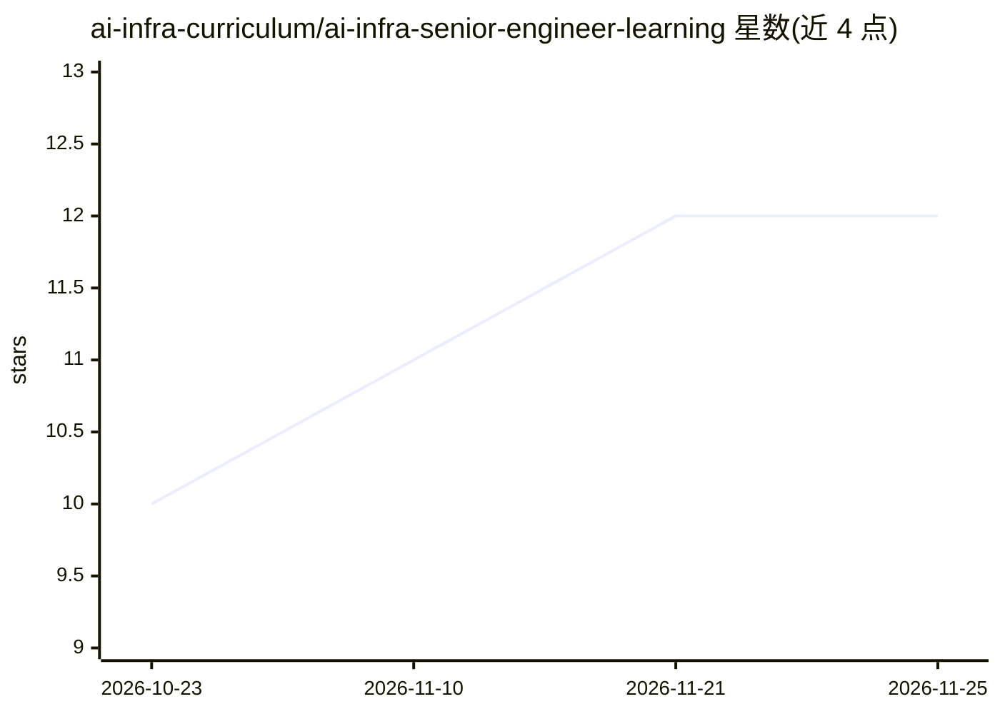

# ai-infra-curriculum/ai-infra-senior-engineer-learning

⭐ 12 · Python · MIT · 推送 2026-11-03 · [GitHub](https://github.com/ai-infra-curriculum/ai-infra-senior-engineer-learning) · 组织维护

**面向 AI 基础设施工程师的高级进阶学习课程（400-500 小时）**

该仓库是 AI Career Curriculum 体系中的 Senior AI Infrastructure Engineer 级别学习材料，包含 10 个模块与 4 个大型项目，总计约 400-500 小时内容。覆盖高级 Kubernetes（自定义 operator、多集群）、分布式训练（Ray、Horovod、PyTorch DDP）、GPU 计算与优化、TensorRT/vLLM 模型服务、多云架构（Terraform/Pulumi）、MLOps、可观测性与 SRE、IaC/GitOps、安全合规及技术领导力。前置要求包括完成工程师级课程或 2-3 年相关经验，以及 16GB+ 内存的开发机与 GPU 访问。

## 筛选速览

| 维度 | 判定 | 备注 |
|---|---|---|
| AI 角色 | `ai-knowledge` | 知识聚合/清单类 |
| 许可风险 | `permissive` | MIT |
| 部署形态 | `None` |  |
| 模型依赖 | — | README 未给出锁定关系 |
| 硬件要求 | — | 无带数字的原话,不猜 |
| 安装摩擦 | `medium` | 含编译或系统依赖之一 |
| 成熟度 | — | 结构信号不足 |

## 能力要点

- 10 个模块 + 4 个项目，约 400-500 小时学习内容
- 覆盖分布式训练、GPU 优化、模型服务、多云与 MLOps 全栈主题
- 每个模块统一结构：讲义、实验、项目与评估
- 设有前置课程要求与 4-7 年资历定位

## 适用场景

- 有 2-3 年 ML 基础设施经验者系统进阶到高级工程师水平
- 按学习路径分阶段完成 Kubernetes、GPU、多云等模块与项目
- 准备高级基础设施岗位的技术面试与架构决策能力

## 场景标签

`教程课程` · 领域:学习与行业

## 证据(README 行号)

> L12: > A comprehensive, hands-on curriculum for advancing from AI Infrastructure Engineer to Senior AI Infrastructure En
> L18: This repository contains the complete learning materials for the **Senior AI Infrastructure Engineer** level of the
> L190: The curriculum is organized into **10 modules** and **4 major projects**, totaling approximately **400-500 hours**

## 星数曲线

2026-10-23 10 → 2026-11-25 12（+2）

---
*卡片 v1 · prompt 1.4 · 生成 2026-11-18 · 置信度 high · 依据 README sha `6eb705e97ae4` · [字段定义](../../DATASET.md)*
