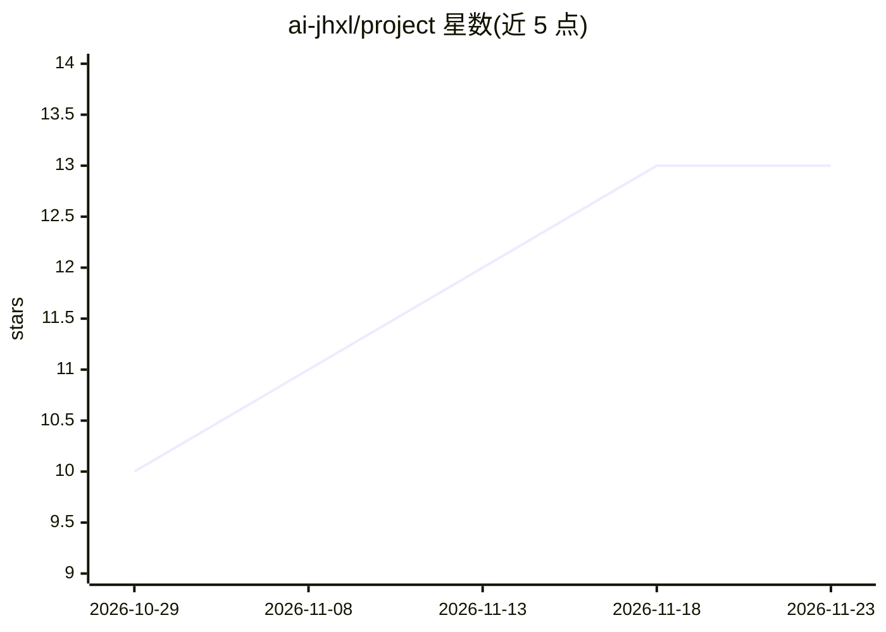

# ai-jhxl/project

⭐ 13 · Python · 推送 2026-02-27 · [GitHub](https://github.com/ai-jhxl/project) · 个人维护 · 中文 README

**给 Python 学习者的 300+ 实战项目中文注释源码合集**

汇总 310 个可运行的 Python 实战案例源码，按基础入门、Web开发、数据分析、爬虫、GUI、游戏、办公自动化、AI/机器学习、图像处理、网络编程 10 大类别组织，每个条目附中文注释。README 以分类清单形式列出项目名与完成状态，供零基础读者逐项练习与检索参考。README 未提供统一安装步骤或依赖清单，各项目所需的第三方库（Flask、Pandas、OpenCV 等）在分类说明中提及。

## 筛选速览

| 维度 | 判定 | 备注 |
|---|---|---|
| AI 角色 | `ai-knowledge` | 知识聚合/清单类 |
| 许可风险 | `none` | — |
| 部署形态 | `None` |  |
| 模型依赖 | — | README 未给出锁定关系 |
| 硬件要求 | — | 无带数字的原话,不猜 |
| 安装摩擦 | `low` | 无编译、无系统依赖或容器化 |
| 成熟度 | — | 结构信号不足 |

## 能力要点

- 310 个实战项目源码，含详细中文注释
- 按 10 大领域分类组织，逐条列出项目名
- 覆盖从语法练习到机器学习、图像处理的梯度内容

## 适用场景

- 零基础学 Python，逐个案例练手
- 查找某类功能的现成示例代码参考
- 按目录索引机器学习、爬虫、办公自动化等入门样例

## 场景标签

`教程课程` · 领域:学习与行业

## 证据(README 行号)

> L9: 这是全网最全面的 Python 实战项目合集！旨在通过 **300+ 个实战案例** 帮助你从零掌握 Python 编程。
> L14: * **全面覆盖**：涵盖 基础入门、Web开发、数据分析、爬虫、GUI、游戏、办公自动化、AI、图像处理、网络编程 10大领域。
> L16: * **详细注释**：每一行代码都有详细的 **中文注释**，小白也能看懂。

## 星数曲线

2026-10-29 10 → 2026-11-23 13（+3）

---
*卡片 v1 · prompt 1.4 · 生成 2026-11-18 · 置信度 high · 依据 README sha `a87dba26a5c8` · [字段定义](../../DATASET.md)*
