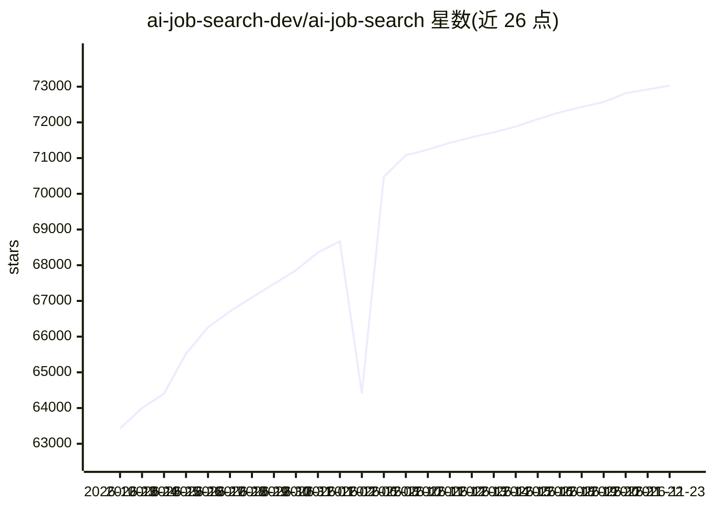

# ai-job-search-dev/ai-job-search

⭐ 73,027 · Python · MIT · 推送 2026-11-22 · [GitHub](https://github.com/ai-job-search-dev/ai-job-search) · 个人维护

**求职者的本地 AI 求职申请框架：评估职位并定制简历**

基于 Claude Code 的求职申请工作流框架，面向自行管理求职过程的用户。提供 13 个命令：/setup 从文档或对话建立个人档案，/scrape 搜索职位，/rank 批量评分，/apply 执行职位评估、简历与求职信起草并由第二个 agent 审阅修订，/interview 生成面试准备包与模拟面试，/outcome 记录结果与跟进。简历经 LaTeX（lualatex/xelatex）编译，含 ATS 可解析性检查。需 Claude Code 订阅或 API 额度，依赖 Python 3.10+、Bun 与 LaTeX 环境。

## 筛选速览

| 维度 | 判定 | 备注 |
|---|---|---|
| AI 角色 | `ai-native` | 本体是模型或模型工具 |
| 许可风险 | `permissive` | MIT |
| 部署形态 | `desktop` | 安装包/桌面程序 |
| 模型依赖 | — | README 未给出锁定关系 |
| 硬件要求 | — | 无带数字的原话,不猜 |
| 安装摩擦 | `low` | 无编译、无系统依赖或容器化 |
| 成熟度 | — | 结构信号不足 |

## 能力要点

- 13 个命令覆盖建档、搜索、排名、投递、面试准备到结果跟踪
- /apply 采用 drafter-reviewer 双 agent 管道并含确定性职位完整性检查
- 简历用 LaTeX 编译并做 ATS 可解析性检查（pypdf）
- 职位门户搜索技能可按市场自行添加（/add-portal、community-portals）

## 适用场景

- 批量生成针对各职位定制化的简历与求职信
- 职位太多时按契合度框架批量评分排序
- 面试前基于已投递材料生成准备包并模拟面试
- 用 Notion 或离线仪表盘跟踪申请管道状态

## 场景标签

`工作流自动化` `AI 写作` · 领域:效率与自动化

## 证据(README 行号)

> L11:  An AI-powered job application framework built on Claude Code.
> L49: A structured workflow that turns Claude Code into a full-stack job application assistant. Six commands carry you fr

## 星数曲线

2026-10-23 63,426 → 2026-11-23 73,027（+9,601）

---
*卡片 v1 · prompt 1.4 · 生成 2026-11-22 · 置信度 mid · 依据 README sha `a65b6886de1e` · [字段定义](../../DATASET.md)*
