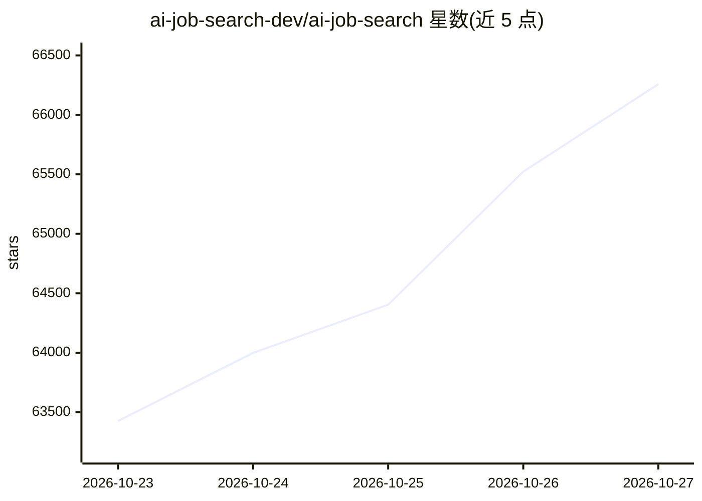

# ai-job-search-dev/ai-job-search

⭐ 66,258 · Python · MIT · 推送 2026-10-26 · [GitHub](https://github.com/ai-job-search-dev/ai-job-search) · 个人维护

**给求职者：本地运行的 AI 求职申请工作流（评估岗位/改简历/写求职信）**

基于 Claude Code 构建的求职申请框架：用户 fork 仓库并填写个人资料后，通过斜杠命令完成岗位抓取（/scrape）、匹配度批量评分（/rank）、求职信与 CV 生成及编译（/apply，LaTeX 双编译器 drafter-reviewer 流水线）、面试准备（/interview）、结果追踪（/outcome）等。岗位招聘帖被当作不可信输入处理，通过确定性完整性检查（隐藏文本/不可见字符等）。求职门户搜索技能默认面向丹麦市场，模式可替换为本地招聘网站。运行需 Claude Code 订阅或 Anthropic API 额度、Python 3.10+、Bun 与 LaTeX 发行版。作者为个人开发者，声明与 Anthropic 无隶属关系。

## 筛选速览

| 维度 | 判定 | 备注 |
|---|---|---|
| AI 角色 | `ai-native` | 本体是模型或模型工具 |
| 许可风险 | `permissive` | MIT |
| 部署形态 | `library` | 以包/库形式分发 |
| 模型依赖 | locked-api |  |
| 硬件要求 | — | 无带数字的原话,不猜 |
| 安装摩擦 | `low` | 无编译、无系统依赖或容器化 |
| 成熟度 | — | 结构信号不足 |

## 能力要点

- drafter-reviewer 双智能体流水线生成并修订 CV 与求职信，强制 PDF 编译
- 岗位帖完整性检查（隐藏文本/不可见字符/隐藏链接），帖内指令不被执行
- 13 个斜杠命令覆盖抓取、评分、申请、面试准备、追踪、复盘全流程
- 求职门户搜索技能可按本地市场替换或用 /add-portal 自动生成

## 适用场景

- 批量评估招聘帖与个人资料的匹配度并排序
- 按具体岗位生成定制 CV 与求职信（LaTeX 编译）
- 面试前基于已投递材料生成针对性准备包
- 追踪每次申请的进展并复盘校准匹配框架

## 场景标签

`工作流自动化` `网页抓取` · 领域:效率与自动化

## 证据(README 行号)

> L11: An AI-powered job application framework built on Claude Code. Fork it, fill in your profile, and let Claude evaluat
> L34: A structured workflow that turns Claude Code into a full-stack job application assistant. The core workflow (self-p

## 星数曲线

2026-10-23 63,426 → 2026-10-27 66,258（+2,832）

---
*卡片 v1 · prompt 1.4 · 生成 2026-10-27 · 置信度 mid · 依据 README sha `ea7bf5eabf7a` · [字段定义](../../DATASET.md)*
