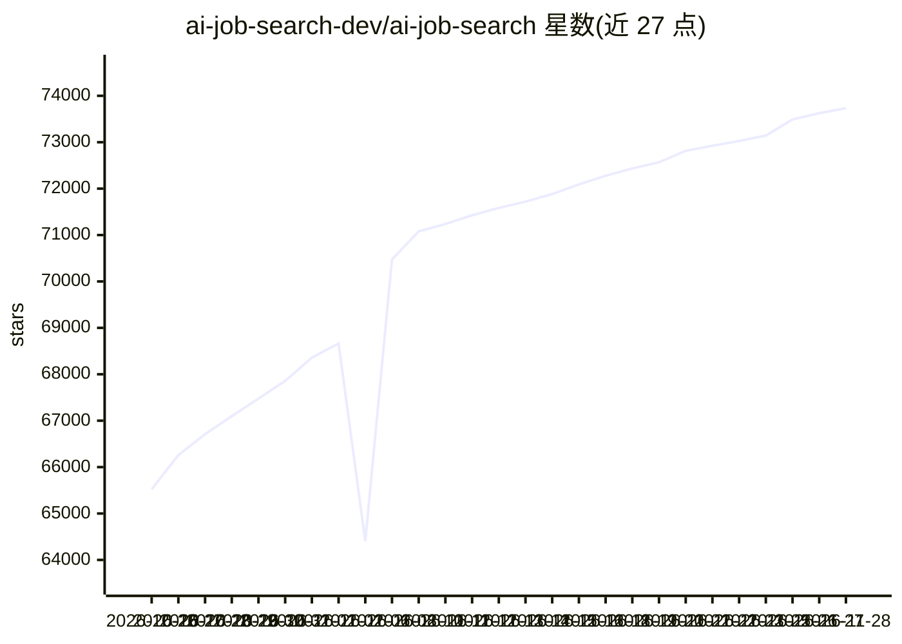

# ai-job-search-dev/ai-job-search

⭐ 73,733 · Python · MIT · 推送 2026-11-27 · [GitHub](https://github.com/ai-job-search-dev/ai-job-search) · 个人维护

**求职者在本地运行 AI 生成定制简历、求职信与面试准备**

基于 Claude Code 的求职申请工作流框架，以六条核心命令（/setup 建档案、/scrape 搜职位、/rank 评分、/apply 生成简历与求职信、/interview 准备面试、/outcome 追踪结果）加上七个扩展命令运行。生成流程采用 drafter-reviewer 双 agent 管道，含职位描述防注入检查、LaTeX 编译 PDF、ATS 可解析性检查。要求 Claude Code 订阅、Python 3.10+、Bun 与 LaTeX。以 fork/克隆仓库形式分发，作者声明与 Anthropic 无关联。

## 筛选速览

| 维度 | 判定 | 备注 |
|---|---|---|
| AI 角色 | `ai-native` | 本体是模型或模型工具 |
| 许可风险 | `permissive` | MIT |
| 部署形态 | `desktop` | 安装包/桌面程序 |
| 模型依赖 | locked-api |  |
| 硬件要求 | — | 无带数字的原话,不猜 |
| 安装摩擦 | `low` | 无编译、无系统依赖或容器化 |
| 成熟度 | — | 结构信号不足 |

## 能力要点

- 六条核心命令加七个扩展命令的完整求职工作流
- drafter-reviewer 双 agent 管道生成并审校简历与求职信
- 职位描述确定性完整性检查（隐藏文本/指令注入检测）
- 简历用 lualatex、求职信用 xelatex 编译输出 PDF

## 适用场景

- 为具体职位定制生成简历和求职信
- 批量给抓取到的职位打分生成候选清单
- 根据职位和过往材料准备面试并模拟问答
- 追踪每次申请的进度并起草跟进信

## 场景标签

`工作流自动化` `AI 写作` · 领域:效率与自动化

## 证据(README 行号)

> L11:  An AI-powered job application framework built on Claude Code.
> L49: A structured workflow that turns Claude Code into a full-stack job application assistant. Six commands carry you fr

## 星数曲线

2026-10-26 65,523 → 2026-11-28 73,733（+8,210）

---
*卡片 v1 · prompt 1.4 · 生成 2026-11-27 · 置信度 mid · 依据 README sha `3077e5104216` · [字段定义](../../DATASET.md)*
