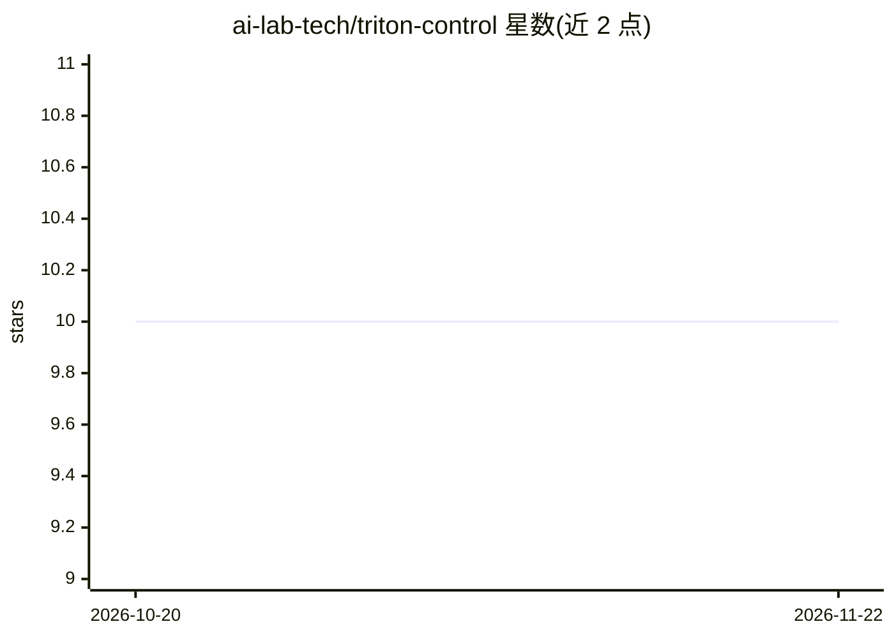

# ai-lab-tech/triton-control

⭐ 10 · Python · Apache-2.0 · 推送 2026-11-21 · [GitHub](https://github.com/ai-lab-tech/triton-control) · [官网](https://ailabtech.net/) · 组织维护

**为 Kubernetes 上的 NVIDIA Triton 推理服务器提供统一 Web 管理界面**

Triton Control 是面向 NVIDIA Triton Inference Server 的开源控制面 Web UI，将部署、模型仓库管理、推理测试、性能分析、开发工作区、MLflow 与 Argo Workflows 整合到同一界面。支持注册管理已有 Triton 实例，在 Kubernetes 中运行时提供自部署 Triton、Perf Analyzer、托管 MLflow 等功能；本地 Docker Compose/Podman 模式下这些 Kubernetes 特定功能被禁用。主要部署方式为 Helm chart，另提供容器镜像与本地 Python/npm 开发模式。

## 筛选速览

| 维度 | 判定 | 备注 |
|---|---|---|
| AI 角色 | `ai-ecosystem` | LLM/agent 周边工具 |
| 许可风险 | `permissive` | Apache-2.0 |
| 部署形态 | `self-host` | docker 或自建部署 |
| 模型依赖 | — | README 未给出锁定关系 |
| 硬件要求 | — | 无带数字的原话,不猜 |
| 安装摩擦 | `low` | 无编译、无系统依赖或容器化 |
| 成熟度 | — | 结构信号不足 |

## 能力要点

- 统一管理 Triton 实例注册、模型仓库与推理测试
- S3 模型仓库集成，含可复用 S3 profile 与内置 S3 Browser
- 基于 code-server 的用户级浏览器开发工作区与用户权限管理
- 内置 MLflow UI 与 Argo Workflows UI（经认证后端代理）

## 适用场景

- 在 Kubernetes 集群中统一部署和运维多个 Triton 推理实例
- 团队通过 S3 仓库管理模型并做推理测试与性能分析
- 为多人提供带访问控制的 Triton 使用入口与开发工作区

## 场景标签

`推理引擎` `MLOps` · 领域:训练与推理

## 证据(README 行号)

> L9: **Operate NVIDIA Triton on Kubernetes from one open-source control plane.**
> L11: Triton Control brings deployment, model repositories, inference testing,
> L42: - self-deployed Triton serving workflows when Triton Control runs in Kubernetes

## 星数曲线

2026-10-20 10 → 2026-11-22 10（+0）

---
*卡片 v1 · prompt 1.4 · 生成 2026-11-20 · 置信度 high · 依据 README sha `731dc602855c` · [字段定义](../../DATASET.md)*
