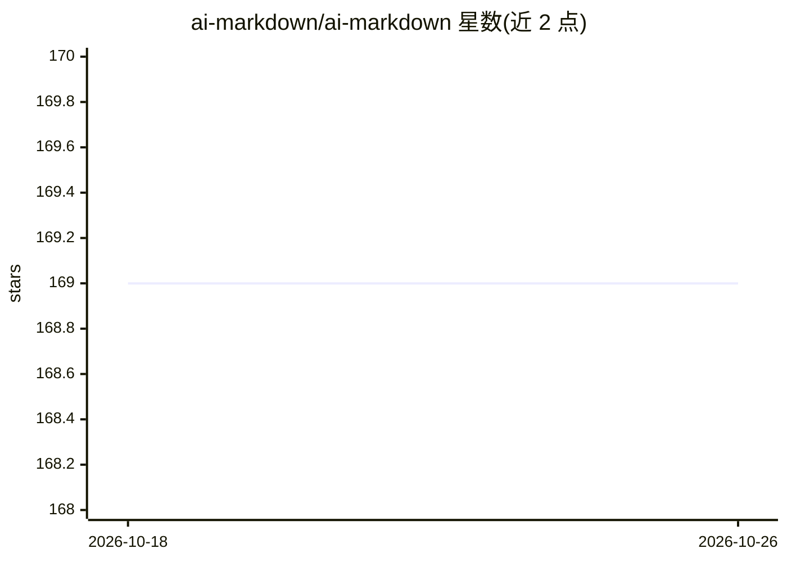

# ai-markdown/ai-markdown

⭐ 169 · TypeScript · MIT · 推送 2026-10-25 · [GitHub](https://github.com/ai-markdown/ai-markdown) · [官网](https://ai-markdown.github.io/) · 组织维护

**面向 AI 聊天应用的流式 Markdown 渲染库（React/Vue）**

为 AI 应用渲染流式 Markdown 回答的组件库：单一组件接收完整当前 Markdown 字符串，引擎在追加输入且语法允许时复用已验证前缀做增量解析，否则全量解析；支持 GFM、KaTeX 数学（含货币符号与括号定界符预处理）、Mermaid 图、CJK 感知解析与 pangu 间距、跨块脚注/引用共享、打字机式平滑流式展示与双门 XSS 防护。React 与 Vue 适配器共享 @ai-markdown/core 与 engine 包，另有 React Mantine 集成。限制：不支持 React 18（需 React 19）与 React Native。

## 筛选速览

| 维度 | 判定 | 备注 |
|---|---|---|
| AI 角色 | `ai-ecosystem` | LLM/agent 周边工具 |
| 许可风险 | `permissive` | MIT |
| 部署形态 | `library` | 以包/库形式分发 |
| 模型依赖 | — | README 未给出锁定关系 |
| 硬件要求 | — | 无带数字的原话,不猜 |
| 安装摩擦 | `low` | 无编译、无系统依赖或容器化 |
| 成熟度 | — | 结构信号不足 |

## 能力要点

- 增量流式解析：追加输入时复用已验证前缀，块级记忆化复用 React 元素
- KaTeX 数学预处理（货币 $、\[…\] 定界符、mhchem）与 CJK 感知解析/pangu 间距
- <AIMarkdownDocuments> 跨块共享脚注与链接/图片定义
- 双门 XSS 防护（urlTransform + rehype-sanitize）与类型化自定义组件

## 适用场景

- AI 聊天界面流式渲染含数学公式与表格的回答
- 中文/中日混排 AI 回答的排版与间距处理
- 多适配器共享 core/engine 的统一渲染方案

## 场景标签

 · 领域:AI 应用前端/Markdown 渲染

## 证据(README 行号)

> L17: > React and Vue Markdown rendering for AI responses: GFM, KaTeX math, CJK-aware parsing, incremental streaming, and
> L27: - **Accumulated streaming input.** Pass the complete current Markdown string to one component. The engine reuses a 
> L65: |`@ai-markdown/react`|React renderer, hooks and customizable typography.|@ai-markdown/react stable|@ai-markdown/rea

## 星数曲线

2026-10-18 169 → 2026-10-26 169（+0）

---
*卡片 v1 · prompt 1.4 · 生成 2026-10-22 · 置信度 high · 依据 README sha `eeb682714823` · [字段定义](../../DATASET.md)*
